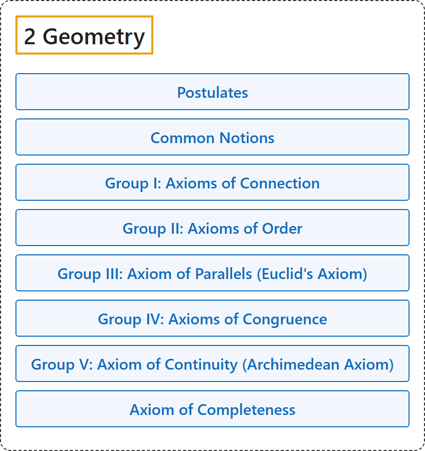

# 2 Geometry

## Classification

## Glossary

| Term | Definition | 中文翻译 | Source |
|---|---|---|---|
| **[2 Geometry](index.md)** 几何 | (No definition) | （无定义） | [Euclid, ca. 300 B.C.E./1996, Book I, "Postulates"](https://mathcs.clarku.edu/~djoyce/elements/bookI/bookI.html#posts) |
| **[Postulates](1-postulates.md)** 公设 | (No definition) | （无定义） | [Euclid, ca. 300 B.C.E./1996, Book I, "Postulates"](https://mathcs.clarku.edu/~djoyce/elements/bookI/bookI.html#posts) |
| **[Common Notions](2-common-notions.md)** 公理（一般概念） | (No definition) | （无定义） | [Euclid, ca. 300 B.C.E./1996, Book I, "Common Notions"](https://mathcs.clarku.edu/~djoyce/elements/bookI/bookI.html#cns) |
| **[Group I: Axioms of Connection](3-group-i-axioms-of-connection.md)** 第一组：关联公理 | "The axioms of this group **establish a connection between the concepts** indicated above; namely, **points, straight lines, and planes**." | 这一组公理**在前面所说的概念之间建立联系**，即**点、直线和平面**。 | [Hilbert, 1902, § 2](https://www.gutenberg.org/ebooks/17384) |
| **[Group II: Axioms of Order](4-group-ii-axioms-of-order.md)** 第二组：顺序公理 | "The axioms of this group **define the idea expressed by the word "between,"** and make possible, upon the basis of this idea, **an order of sequence of the points** upon a straight line, in a plane, and in space." | 这一组公理**定义“在……之间”这个词所表达的概念**，并在此基础上，使直线上、平面上和空间中的**点有先后顺序**。 | [Hilbert, 1902, § 3](https://www.gutenberg.org/ebooks/17384) |
| **[Group III: Axiom of Parallels (Euclid's Axiom)](5-group-iii-axiom-of-parallels-euclid-s-axiom.md)** 第三组：平行公理（欧几里得公理） | "The introduction of this axiom **simplifies greatly the fundamental principles of geometry** and facilitates in no small degree its development." | 引入这条公理**大大简化了几何的基本原理**，并在很大程度上便利了几何的发展。 | [Hilbert, 1902, § 5](https://www.gutenberg.org/ebooks/17384) |
| **[Group IV: Axioms of Congruence](6-group-iv-axioms-of-congruence.md)** 第四组：合同公理 | "The axioms of this group **define the idea of congruence or displacement**." | 这一组公理**定义合同（全等）或移动的概念**。 | [Hilbert, 1902, § 6](https://www.gutenberg.org/ebooks/17384) |
| **[Group V: Axiom of Continuity (Archimedean Axiom)](7-group-v-axiom-of-continuity-archimedean-axiom.md)** 第五组：连续公理（阿基米德公理） | "This axiom **makes possible the introduction into geometry of the idea of continuity**." | 这条公理**使连续性的概念得以引入几何**。 | [Hilbert, 1902, § 8](https://www.gutenberg.org/ebooks/17384) |
| **[Axiom of Completeness](8-axiom-of-completeness.md)** 完备公理 | "To the preceeding five groups of axioms, we may add the following one, which, although **not of a purely geometrical nature**, merits particular attention from a theoretical point of view." | 在前面五组公理之外，还可以加上下面这一条，它虽然**不纯粹是几何性质的**，但从理论上看值得特别注意。 | [Hilbert, 1902, § 8](https://www.gutenberg.org/ebooks/17384) |

## References

Euclid. (1996). *Euclid's Elements* (D. E. Joyce, Ed.; T. L. Heath, Trans.). Clark University. (Original work published ca. 300 B.C.E.) Retrieved October 29, 2026, from <https://mathcs.clarku.edu/~djoyce/elements/bookI/bookI.html>

Hilbert, D. (1902). *The foundations of geometry* (E. J. Townsend, Trans.). Open Court. Project Gutenberg. <https://www.gutenberg.org/ebooks/17384>

Megill, N. (2026). *Metamath Proof Explorer home page* (last updated January 19, 2026). Metamath. Retrieved October 29, 2026, from <https://us.metamath.org/mpeuni/mmset.html>
