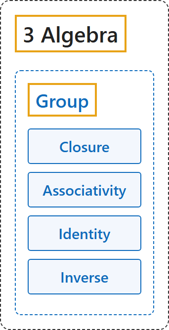

# Group

## Classification

## Glossary

| Term | Definition | 中文翻译 | Source |
|---|---|---|---|
| **[3 Algebra](index.md)** 代数 | (No definition) | （无定义） | [Weisstein, n.d., "Group" entry](https://mathworld.wolfram.com/Group.html) |
| **[Group](1-group.md)** 群 | "A group G is a finite or infinite set of group elements together with a group operation that satisfies **the four fundamental properties of closure, associativity, the existence of an identity element, and the existence of inverse elements**." | 群 G 是由有限或无限个群元素组成的集合，连同一个群运算，满足**四条基本性质：封闭性、结合律、存在单位元、存在逆元**。 | [Weisstein, n.d., "Group" entry](https://mathworld.wolfram.com/Group.html) |
| **Closure** 封闭性 | "If A and B are group elements in G, then the product AB is also in G." | 若 A、B 是 G 中的元素，则乘积 AB 也在 G 中。 | [Weisstein, n.d., "Group" entry](https://mathworld.wolfram.com/Group.html) |
| **Associativity** 结合律 | "The defined multiplication is associative, i.e., for all A,B,C in G, (AB)C=A(BC)." | 运算满足结合律：对 G 中所有 A、B、C，(AB)C = A(BC)。 | [Weisstein, n.d., "Group" entry](https://mathworld.wolfram.com/Group.html) |
| **Identity** 单位元 | "There is an identity element I (a.k.a. 1, E, or e) such that IA=AI=A for every group element A in G." | 存在单位元 I（也记作 1、E 或 e），对 G 中每个元素 A 都有 IA = AI = A。 | [Weisstein, n.d., "Group" entry](https://mathworld.wolfram.com/Group.html) |
| **Inverse** 逆元 | "There must be an inverse element (a.k.a. reciprocal) of each group element. Therefore, for each group element A of G, the set contains a group element B=A^(-1) such that AA^(-1)=A^(-1)A=I." | 每个元素都有逆元：对 G 中每个 A，G 中有 B = A⁻¹，使 AA⁻¹ = A⁻¹A = I。 | [Weisstein, n.d., "Group" entry](https://mathworld.wolfram.com/Group.html) |

## References

Megill, N. (2026). *Metamath Proof Explorer home page* (last updated January 19, 2026). Metamath. Retrieved October 29, 2026, from <https://us.metamath.org/mpeuni/mmset.html>

Weisstein, E. W. (n.d.). *Field axioms*. MathWorld. Retrieved October 29, 2026, from <https://mathworld.wolfram.com/FieldAxioms.html>

Weisstein, E. W. (n.d.). *Group*. MathWorld. Retrieved October 29, 2026, from <https://mathworld.wolfram.com/Group.html>

Weisstein, E. W. (n.d.). *Ring*. MathWorld. Retrieved October 29, 2026, from <https://mathworld.wolfram.com/Ring.html>

Weisstein, E. W. (n.d.). *Vector space*. MathWorld. Retrieved October 29, 2026, from <https://mathworld.wolfram.com/VectorSpace.html>
