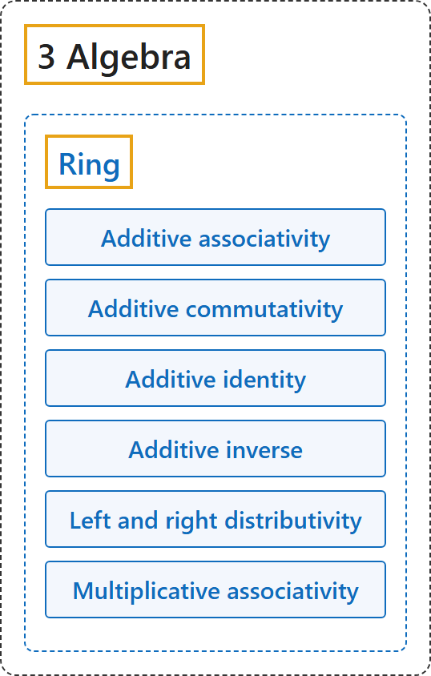

# Ring

## Classification

## Glossary

| Term | Definition | 中文翻译 | Source |
|---|---|---|---|
| **[3 Algebra](index.md)** 代数 | (No definition) | （无定义） | [Weisstein, n.d., "Group" entry](https://mathworld.wolfram.com/Group.html) |
| **[Ring](2-ring.md)** 环 | "A ring in the mathematical sense is **a set S together with two binary operators** + and \* (commonly interpreted as addition and multiplication, respectively) satisfying the following conditions" | 数学意义上的环是**一个集合 S 连同两个二元运算** + 和 \*（通常分别解释为加法和乘法），并满足以下条件 | [Weisstein, n.d., "Ring" entry](https://mathworld.wolfram.com/Ring.html) |
| **Additive associativity** 加法结合律 | "For all a,b,c in S, (a+b)+c=a+(b+c)" | 对 S 中所有 a、b、c，(a+b)+c = a+(b+c)。 | [Weisstein, n.d., "Ring" entry](https://mathworld.wolfram.com/Ring.html) |
| **Additive commutativity** 加法交换律 | "For all a,b in S, a+b=b+a" | 对 S 中所有 a、b，a+b = b+a。 | [Weisstein, n.d., "Ring" entry](https://mathworld.wolfram.com/Ring.html) |
| **Additive identity** 加法单位元 | "There exists an element 0 in S such that for all a in S, 0+a=a+0=a" | S 中有元素 0，对所有 a 都有 0+a = a+0 = a。 | [Weisstein, n.d., "Ring" entry](https://mathworld.wolfram.com/Ring.html) |
| **Additive inverse** 加法逆元 | "For every a in S there exists -a in S such that a+(-a)=(-a)+a=0" | 对 S 中每个 a，有 -a 使 a+(-a) = (-a)+a = 0。 | [Weisstein, n.d., "Ring" entry](https://mathworld.wolfram.com/Ring.html) |
| **Left and right distributivity** 左、右分配律 | "For all a,b,c in S, a\*(b+c)=(a\*b)+(a\*c) and (b+c)\*a=(b\*a)+(c\*a)" | 对 S 中所有 a、b、c，a\*(b+c) = (a\*b)+(a\*c)，(b+c)\*a = (b\*a)+(c\*a)。 | [Weisstein, n.d., "Ring" entry](https://mathworld.wolfram.com/Ring.html) |
| **Multiplicative associativity** 乘法结合律 | "For all a,b,c in S, (a\*b)\*c=a\*(b\*c)" | 对 S 中所有 a、b、c，(a\*b)\*c = a\*(b\*c)。 | [Weisstein, n.d., "Ring" entry](https://mathworld.wolfram.com/Ring.html) |

## References

Megill, N. (2026). *Metamath Proof Explorer home page* (last updated January 19, 2026). Metamath. Retrieved October 29, 2026, from <https://us.metamath.org/mpeuni/mmset.html>

Weisstein, E. W. (n.d.). *Field axioms*. MathWorld. Retrieved October 29, 2026, from <https://mathworld.wolfram.com/FieldAxioms.html>

Weisstein, E. W. (n.d.). *Group*. MathWorld. Retrieved October 29, 2026, from <https://mathworld.wolfram.com/Group.html>

Weisstein, E. W. (n.d.). *Ring*. MathWorld. Retrieved October 29, 2026, from <https://mathworld.wolfram.com/Ring.html>

Weisstein, E. W. (n.d.). *Vector space*. MathWorld. Retrieved October 29, 2026, from <https://mathworld.wolfram.com/VectorSpace.html>
