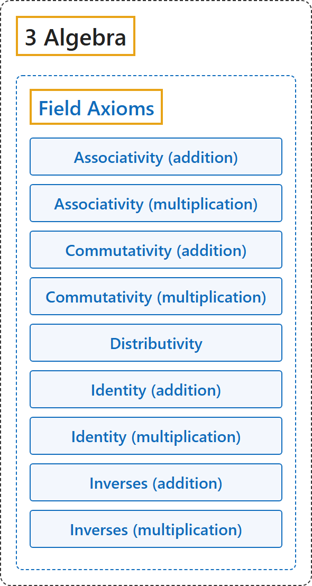

# Field Axioms

## Classification

## Glossary

| Term | Definition | 中文翻译 | Source |
|---|---|---|---|
| **[3 Algebra](index.md)** 代数 | (No definition) | （无定义） | [Weisstein, n.d., "Group" entry](https://mathworld.wolfram.com/Group.html) |
| **[Field Axioms](3-field-axioms.md)** 域公理 | "The field axioms are **conditions on two binary operations, addition and multiplication, on a set F**." | 域公理是**对集合 F 上加法和乘法这两个二元运算的条件**。 | [Weisstein, n.d., "Field axioms" entry](https://mathworld.wolfram.com/FieldAxioms.html) |
| **Associativity (addition)** 加法结合律 | "(a+b)+c=a+(b+c)" | (a+b)+c = a+(b+c)。 | [Weisstein, n.d., "Field axioms" entry](https://mathworld.wolfram.com/FieldAxioms.html) |
| **Associativity (multiplication)** 乘法结合律 | "(ab)c=a(bc)" | (ab)c = a(bc)。 | [Weisstein, n.d., "Field axioms" entry](https://mathworld.wolfram.com/FieldAxioms.html) |
| **Commutativity (addition)** 加法交换律 | "a+b=b+a" | a+b = b+a。 | [Weisstein, n.d., "Field axioms" entry](https://mathworld.wolfram.com/FieldAxioms.html) |
| **Commutativity (multiplication)** 乘法交换律 | "ab=ba" | ab = ba。 | [Weisstein, n.d., "Field axioms" entry](https://mathworld.wolfram.com/FieldAxioms.html) |
| **Distributivity** 分配律 | "a(b+c)=ab+ac, (a+b)c=ac+bc" | a(b+c) = ab+ac，(a+b)c = ac+bc。 | [Weisstein, n.d., "Field axioms" entry](https://mathworld.wolfram.com/FieldAxioms.html) |
| **Identity (addition)** 加法单位元 | "a+0=a=0+a" | a+0 = a = 0+a。 | [Weisstein, n.d., "Field axioms" entry](https://mathworld.wolfram.com/FieldAxioms.html) |
| **Identity (multiplication)** 乘法单位元 | "a⋅1=a=1⋅a" | a⋅1 = a = 1⋅a。 | [Weisstein, n.d., "Field axioms" entry](https://mathworld.wolfram.com/FieldAxioms.html) |
| **Inverses (addition)** 加法逆元 | "a+(-a)=0=(-a)+a" | a+(-a) = 0 = (-a)+a。 | [Weisstein, n.d., "Field axioms" entry](https://mathworld.wolfram.com/FieldAxioms.html) |
| **Inverses (multiplication)** 乘法逆元 | "aa^(-1)=1=a^(-1)a if a≠0" | a ≠ 0 时，aa⁻¹ = 1 = a⁻¹a。 | [Weisstein, n.d., "Field axioms" entry](https://mathworld.wolfram.com/FieldAxioms.html) |

## References

Megill, N. (2026). *Metamath Proof Explorer home page* (last updated January 19, 2026). Metamath. Retrieved October 29, 2026, from <https://us.metamath.org/mpeuni/mmset.html>

Weisstein, E. W. (n.d.). *Field axioms*. MathWorld. Retrieved October 29, 2026, from <https://mathworld.wolfram.com/FieldAxioms.html>

Weisstein, E. W. (n.d.). *Group*. MathWorld. Retrieved October 29, 2026, from <https://mathworld.wolfram.com/Group.html>

Weisstein, E. W. (n.d.). *Ring*. MathWorld. Retrieved October 29, 2026, from <https://mathworld.wolfram.com/Ring.html>

Weisstein, E. W. (n.d.). *Vector space*. MathWorld. Retrieved October 29, 2026, from <https://mathworld.wolfram.com/VectorSpace.html>
