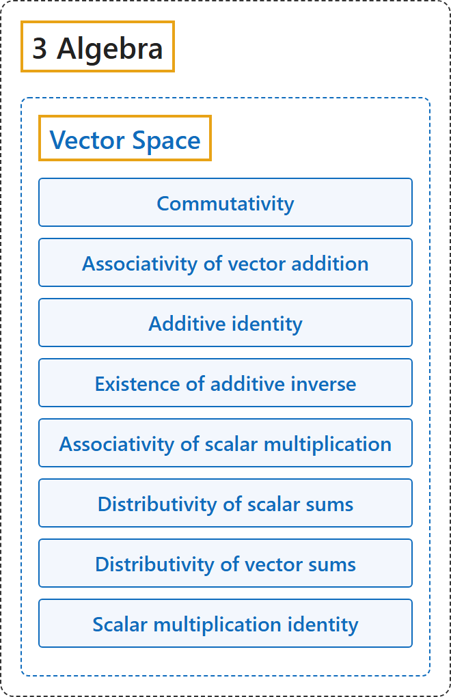

# Vector Space

## Classification

## Glossary

| Term | Definition | 中文翻译 | Source |
|---|---|---|---|
| **[3 Algebra](index.md)** 代数 | (No definition) | （无定义） | [Weisstein, n.d., "Group" entry](https://mathworld.wolfram.com/Group.html) |
| **[Vector Space](4-vector-space.md)** 向量空间 | "A vector space V is **a set equipped with vector addition and scalar multiplication** satisfying the axioms below." | 向量空间 V 是**配有向量加法和数乘的集合**，满足下列公理。 | [Weisstein, n.d., "Vector space" entry](https://mathworld.wolfram.com/VectorSpace.html) |
| **Commutativity** 交换律 | "X+Y=Y+X." | X+Y = Y+X。 | [Weisstein, n.d., "Vector space" entry](https://mathworld.wolfram.com/VectorSpace.html) |
| **Associativity of vector addition** 向量加法结合律 | "(X+Y)+Z=X+(Y+Z)." | (X+Y)+Z = X+(Y+Z)。 | [Weisstein, n.d., "Vector space" entry](https://mathworld.wolfram.com/VectorSpace.html) |
| **Additive identity** 加法单位元 | "For all X, 0+X=X+0=X." | 对所有 X，0+X = X+0 = X。 | [Weisstein, n.d., "Vector space" entry](https://mathworld.wolfram.com/VectorSpace.html) |
| **Existence of additive inverse** 存在加法逆元 | "For any X, there exists a -X such that X+(-X)=0." | 对任意 X，存在 -X 使 X+(-X) = 0。 | [Weisstein, n.d., "Vector space" entry](https://mathworld.wolfram.com/VectorSpace.html) |
| **Associativity of scalar multiplication** 数乘结合律 | "r(sX)=(rs)X." | r(sX) = (rs)X。 | [Weisstein, n.d., "Vector space" entry](https://mathworld.wolfram.com/VectorSpace.html) |
| **Distributivity of scalar sums** 数量和的分配律 | "(r+s)X=rX+sX." | (r+s)X = rX+sX。 | [Weisstein, n.d., "Vector space" entry](https://mathworld.wolfram.com/VectorSpace.html) |
| **Distributivity of vector sums** 向量和的分配律 | "r(X+Y)=rX+rY." | r(X+Y) = rX+rY。 | [Weisstein, n.d., "Vector space" entry](https://mathworld.wolfram.com/VectorSpace.html) |
| **Scalar multiplication identity** 数乘单位元 | "1X=X." | 1X = X。 | [Weisstein, n.d., "Vector space" entry](https://mathworld.wolfram.com/VectorSpace.html) |

## References

Megill, N. (2026). *Metamath Proof Explorer home page* (last updated January 19, 2026). Metamath. Retrieved October 29, 2026, from <https://us.metamath.org/mpeuni/mmset.html>

Weisstein, E. W. (n.d.). *Field axioms*. MathWorld. Retrieved October 29, 2026, from <https://mathworld.wolfram.com/FieldAxioms.html>

Weisstein, E. W. (n.d.). *Group*. MathWorld. Retrieved October 29, 2026, from <https://mathworld.wolfram.com/Group.html>

Weisstein, E. W. (n.d.). *Ring*. MathWorld. Retrieved October 29, 2026, from <https://mathworld.wolfram.com/Ring.html>

Weisstein, E. W. (n.d.). *Vector space*. MathWorld. Retrieved October 29, 2026, from <https://mathworld.wolfram.com/VectorSpace.html>
