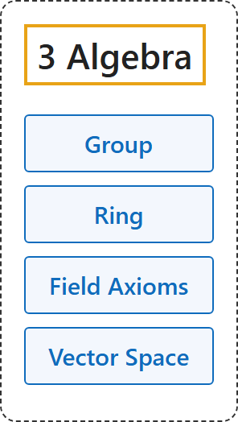

# 3 Algebra

## Classification

## Glossary

| Term | Definition | 中文翻译 | Source |
|---|---|---|---|
| **[3 Algebra](index.md)** 代数 | (No definition) | （无定义） | [Weisstein, n.d., "Group" entry](https://mathworld.wolfram.com/Group.html) |
| **[Group](1-group.md)** 群 | "A group G is a finite or infinite set of group elements together with a group operation that satisfies **the four fundamental properties of closure, associativity, the existence of an identity element, and the existence of inverse elements**." | 群 G 是由有限或无限个群元素组成的集合，连同一个群运算，满足**四条基本性质：封闭性、结合律、存在单位元、存在逆元**。 | [Weisstein, n.d., "Group" entry](https://mathworld.wolfram.com/Group.html) |
| **[Ring](2-ring.md)** 环 | "A ring in the mathematical sense is **a set S together with two binary operators** + and \* (commonly interpreted as addition and multiplication, respectively) satisfying the following conditions" | 数学意义上的环是**一个集合 S 连同两个二元运算** + 和 \*（通常分别解释为加法和乘法），并满足以下条件 | [Weisstein, n.d., "Ring" entry](https://mathworld.wolfram.com/Ring.html) |
| **[Field Axioms](3-field-axioms.md)** 域公理 | "The field axioms are **conditions on two binary operations, addition and multiplication, on a set F**." | 域公理是**对集合 F 上加法和乘法这两个二元运算的条件**。 | [Weisstein, n.d., "Field axioms" entry](https://mathworld.wolfram.com/FieldAxioms.html) |
| **[Vector Space](4-vector-space.md)** 向量空间 | "A vector space V is **a set equipped with vector addition and scalar multiplication** satisfying the axioms below." | 向量空间 V 是**配有向量加法和数乘的集合**，满足下列公理。 | [Weisstein, n.d., "Vector space" entry](https://mathworld.wolfram.com/VectorSpace.html) |

## References

Megill, N. (2026). *Metamath Proof Explorer home page* (last updated January 19, 2026). Metamath. Retrieved October 29, 2026, from <https://us.metamath.org/mpeuni/mmset.html>

Weisstein, E. W. (n.d.). *Field axioms*. MathWorld. Retrieved October 29, 2026, from <https://mathworld.wolfram.com/FieldAxioms.html>

Weisstein, E. W. (n.d.). *Group*. MathWorld. Retrieved October 29, 2026, from <https://mathworld.wolfram.com/Group.html>

Weisstein, E. W. (n.d.). *Ring*. MathWorld. Retrieved October 29, 2026, from <https://mathworld.wolfram.com/Ring.html>

Weisstein, E. W. (n.d.). *Vector space*. MathWorld. Retrieved October 29, 2026, from <https://mathworld.wolfram.com/VectorSpace.html>
