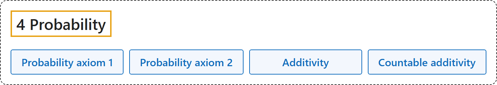

# 4 Probability

## Classification

## Glossary

| Term | Definition | 中文翻译 | Source |
|---|---|---|---|
| **[4 Probability](4-probability.md)** 概率 | "Probability axioms state that, given an event E in a sample space S which is either finite with N elements or countably infinite with N=∞ elements, we can write S=⋃_(i=1)^N E_i, and **a quantity P(E_i), called the probability of event E_i**, is defined such that" | 概率公理说：给定样本空间 S（有限，有 N 个元素；或可数无限，N = ∞）中的事件 E，可以写成 S = ⋃ Eᵢ，并且定义一个量 P(Eᵢ)，**称为事件 Eᵢ 的概率**，使得 | [Weisstein, n.d., "Probability axioms" entry](https://mathworld.wolfram.com/ProbabilityAxioms.html) |
| **Probability axiom 1** 概率公理 1（非负且不超过 1） | "0≤P(E_i)≤1." | 每个事件的概率在 0 和 1 之间。 | [Weisstein, n.d., "Probability axioms" entry](https://mathworld.wolfram.com/ProbabilityAxioms.html) |
| **Probability axiom 2** 概率公理 2（规范性） | "P(S)=1." | 整个样本空间的概率是 1。 | [Weisstein, n.d., "Probability axioms" entry](https://mathworld.wolfram.com/ProbabilityAxioms.html) |
| **Additivity** 可加性 | "P(E_1 ∪ E_2)=P(E_1)+P(E_2), where E_1 and E_2 are mutually exclusive." | E₁、E₂ 互斥时，P(E₁ ∪ E₂) = P(E₁) + P(E₂)。 | [Weisstein, n.d., "Probability axioms" entry](https://mathworld.wolfram.com/ProbabilityAxioms.html) |
| **Countable additivity** 可数可加性 | "P(⋃_(i=1)^n E_i)=∑_(i=1)^n P(E_i) for n=1, 2, ..., N where E_1, E_2, ... are mutually exclusive (i.e., E_1 ∩ E_2=∅)." | E₁、E₂、…两两互斥时，并集的概率等于各自概率之和（n 可以到 N，包括无穷）。 | [Weisstein, n.d., "Probability axioms" entry](https://mathworld.wolfram.com/ProbabilityAxioms.html) |

## References

Megill, N. (2026). *Metamath Proof Explorer home page* (last updated January 19, 2026). Metamath. Retrieved October 29, 2026, from <https://us.metamath.org/mpeuni/mmset.html>

Weisstein, E. W. (n.d.). *Probability axioms*. MathWorld. Retrieved October 29, 2026, from <https://mathworld.wolfram.com/ProbabilityAxioms.html>
