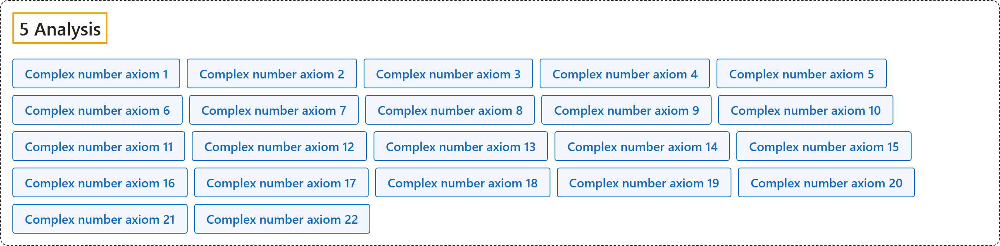

# 5 Analysis

## Classification

## Glossary

| Term | Definition | 中文翻译 | Source |
|---|---|---|---|
| **[5 Analysis](5-analysis.md)** 分析 | "We then assert that these eight objects have **the properties specified by the axioms in the table below, as extensions to ZFC set theory**." | 然后我们断言这八个对象具有**下表公理所规定的性质，作为 ZFC 集合论的扩充**。 | [Megill, n.d.-c, "The 22 Axioms for Complex Numbers" table](https://us.metamath.org/mpeuni/mmcomplex.html) |
| **Complex number axiom 1** 复数公理 1 | "⊢ ℝ ⊆ ℂ" | 实数集是复数集的子集。 | [Megill, n.d.-c, "The 22 Axioms for Complex Numbers" table](https://us.metamath.org/mpeuni/mmcomplex.html) |
| **Complex number axiom 2** 复数公理 2 | "⊢ 1 ∈ ℂ" | 1 是复数。 | [Megill, n.d.-c, "The 22 Axioms for Complex Numbers" table](https://us.metamath.org/mpeuni/mmcomplex.html) |
| **Complex number axiom 3** 复数公理 3 | "⊢ i ∈ ℂ" | i 是复数。 | [Megill, n.d.-c, "The 22 Axioms for Complex Numbers" table](https://us.metamath.org/mpeuni/mmcomplex.html) |
| **Complex number axiom 4** 复数公理 4 | "⊢ ((𝐴 ∈ ℂ ∧ 𝐵 ∈ ℂ) → (𝐴 + 𝐵) ∈ ℂ)" | 复数对加法封闭。 | [Megill, n.d.-c, "The 22 Axioms for Complex Numbers" table](https://us.metamath.org/mpeuni/mmcomplex.html) |
| **Complex number axiom 5** 复数公理 5 | "⊢ ((𝐴 ∈ ℝ ∧ 𝐵 ∈ ℝ) → (𝐴 + 𝐵) ∈ ℝ)" | 实数对加法封闭。 | [Megill, n.d.-c, "The 22 Axioms for Complex Numbers" table](https://us.metamath.org/mpeuni/mmcomplex.html) |
| **Complex number axiom 6** 复数公理 6 | "⊢ ((𝐴 ∈ ℂ ∧ 𝐵 ∈ ℂ) → (𝐴 ⋅ 𝐵) ∈ ℂ)" | 复数对乘法封闭。 | [Megill, n.d.-c, "The 22 Axioms for Complex Numbers" table](https://us.metamath.org/mpeuni/mmcomplex.html) |
| **Complex number axiom 7** 复数公理 7 | "⊢ ((𝐴 ∈ ℝ ∧ 𝐵 ∈ ℝ) → (𝐴 ⋅ 𝐵) ∈ ℝ)" | 实数对乘法封闭。 | [Megill, n.d.-c, "The 22 Axioms for Complex Numbers" table](https://us.metamath.org/mpeuni/mmcomplex.html) |
| **Complex number axiom 8** 复数公理 8 | "⊢ ((𝐴 ∈ ℂ ∧ 𝐵 ∈ ℂ) → (𝐴 ⋅ 𝐵) = (𝐵 ⋅ 𝐴))" | 复数乘法交换律。 | [Megill, n.d.-c, "The 22 Axioms for Complex Numbers" table](https://us.metamath.org/mpeuni/mmcomplex.html) |
| **Complex number axiom 9** 复数公理 9 | "⊢ ((𝐴 ∈ ℂ ∧ 𝐵 ∈ ℂ ∧ 𝐶 ∈ ℂ) → ((𝐴 + 𝐵) + 𝐶) = (𝐴 + (𝐵 + 𝐶)))" | 复数加法结合律。 | [Megill, n.d.-c, "The 22 Axioms for Complex Numbers" table](https://us.metamath.org/mpeuni/mmcomplex.html) |
| **Complex number axiom 10** 复数公理 10 | "⊢ ((𝐴 ∈ ℂ ∧ 𝐵 ∈ ℂ ∧ 𝐶 ∈ ℂ) → ((𝐴 ⋅ 𝐵) ⋅ 𝐶) = (𝐴 ⋅ (𝐵 ⋅ 𝐶)))" | 复数乘法结合律。 | [Megill, n.d.-c, "The 22 Axioms for Complex Numbers" table](https://us.metamath.org/mpeuni/mmcomplex.html) |
| **Complex number axiom 11** 复数公理 11 | "⊢ ((𝐴 ∈ ℂ ∧ 𝐵 ∈ ℂ ∧ 𝐶 ∈ ℂ) → (𝐴 ⋅ (𝐵 + 𝐶)) = ((𝐴 ⋅ 𝐵) + (𝐴 ⋅ 𝐶)))" | 乘法对加法的分配律。 | [Megill, n.d.-c, "The 22 Axioms for Complex Numbers" table](https://us.metamath.org/mpeuni/mmcomplex.html) |
| **Complex number axiom 12** 复数公理 12 | "⊢ ((i ⋅ i) + 1) = 0" | i ⋅ i + 1 = 0，即 i² = -1。 | [Megill, n.d.-c, "The 22 Axioms for Complex Numbers" table](https://us.metamath.org/mpeuni/mmcomplex.html) |
| **Complex number axiom 13** 复数公理 13 | "⊢ 1 ≠ 0" | 1 不等于 0。 | [Megill, n.d.-c, "The 22 Axioms for Complex Numbers" table](https://us.metamath.org/mpeuni/mmcomplex.html) |
| **Complex number axiom 14** 复数公理 14 | "⊢ (𝐴 ∈ ℂ → (𝐴 ⋅ 1) = 𝐴)" | 任何复数乘以 1 等于它本身。 | [Megill, n.d.-c, "The 22 Axioms for Complex Numbers" table](https://us.metamath.org/mpeuni/mmcomplex.html) |
| **Complex number axiom 15** 复数公理 15 | "⊢ (𝐴 ∈ ℝ → ∃𝑥 ∈ ℝ (𝐴 + 𝑥) = 0)" | 每个实数都有加法逆元（相反数）。 | [Megill, n.d.-c, "The 22 Axioms for Complex Numbers" table](https://us.metamath.org/mpeuni/mmcomplex.html) |
| **Complex number axiom 16** 复数公理 16 | "⊢ ((𝐴 ∈ ℝ ∧ 𝐴 ≠ 0) → ∃𝑥 ∈ ℝ (𝐴 ⋅ 𝑥) = 1)" | 每个非零实数都有乘法逆元（倒数）。 | [Megill, n.d.-c, "The 22 Axioms for Complex Numbers" table](https://us.metamath.org/mpeuni/mmcomplex.html) |
| **Complex number axiom 17** 复数公理 17 | "⊢ (𝐴 ∈ ℂ → ∃𝑥 ∈ ℝ ∃𝑦 ∈ ℝ 𝐴 = (𝑥 + (i ⋅ 𝑦)))" | 每个复数都能写成 x + iy，x、y 是实数。 | [Megill, n.d.-c, "The 22 Axioms for Complex Numbers" table](https://us.metamath.org/mpeuni/mmcomplex.html) |
| **Complex number axiom 18** 复数公理 18 | "⊢ ((𝐴 ∈ ℝ ∧ 𝐵 ∈ ℝ) → (𝐴 <ℝ 𝐵 ↔ ¬ (𝐴 = 𝐵 ∨ 𝐵 <ℝ 𝐴)))" | 三歧性：两个实数中，A < B、A = B、B < A 恰有一个成立。 | [Megill, n.d.-c, "The 22 Axioms for Complex Numbers" table](https://us.metamath.org/mpeuni/mmcomplex.html) |
| **Complex number axiom 19** 复数公理 19 | "⊢ ((𝐴 ∈ ℝ ∧ 𝐵 ∈ ℝ ∧ 𝐶 ∈ ℝ) → ((𝐴 <ℝ 𝐵 ∧ 𝐵 <ℝ 𝐶) → 𝐴 <ℝ 𝐶))" | 传递性：A < B 且 B < C，则 A < C。 | [Megill, n.d.-c, "The 22 Axioms for Complex Numbers" table](https://us.metamath.org/mpeuni/mmcomplex.html) |
| **Complex number axiom 20** 复数公理 20 | "⊢ ((𝐴 ∈ ℝ ∧ 𝐵 ∈ ℝ ∧ 𝐶 ∈ ℝ) → (𝐴 <ℝ 𝐵 → (𝐶 + 𝐴) <ℝ (𝐶 + 𝐵)))" | 不等式两边加同一个数，方向不变。 | [Megill, n.d.-c, "The 22 Axioms for Complex Numbers" table](https://us.metamath.org/mpeuni/mmcomplex.html) |
| **Complex number axiom 21** 复数公理 21 | "⊢ ((𝐴 ∈ ℝ ∧ 𝐵 ∈ ℝ) → ((0 <ℝ 𝐴 ∧ 0 <ℝ 𝐵) → 0 <ℝ (𝐴 ⋅ 𝐵)))" | 两个正数的积是正数。 | [Megill, n.d.-c, "The 22 Axioms for Complex Numbers" table](https://us.metamath.org/mpeuni/mmcomplex.html) |
| **Complex number axiom 22** 复数公理 22 | "⊢ ((𝐴 ⊆ ℝ ∧ 𝐴 ≠ ∅ ∧ ∃𝑥 ∈ ℝ ∀𝑦 ∈ 𝐴 𝑦 <ℝ 𝑥) → ∃𝑥 ∈ ℝ (∀𝑦 ∈ 𝐴 ¬ 𝑥 <ℝ 𝑦 ∧ ∀𝑦 ∈ ℝ (𝑦 <ℝ 𝑥 → ∃𝑧 ∈ 𝐴 𝑦 <ℝ 𝑧)))" | 完备性（确界公理）：非空且有上界的实数集有最小上界（上确界）。 | [Megill, n.d.-c, "The 22 Axioms for Complex Numbers" table](https://us.metamath.org/mpeuni/mmcomplex.html) |

## References

Megill, N. (2026). *Metamath Proof Explorer home page* (last updated January 19, 2026). Metamath. Retrieved October 29, 2026, from <https://us.metamath.org/mpeuni/mmset.html>

Megill, N. (n.d.-c). *Real and complex numbers: Metamath Proof Explorer*. Metamath. Retrieved October 29, 2026, from <https://us.metamath.org/mpeuni/mmcomplex.html>
