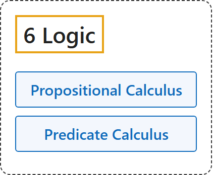

# 6 Logic

## Classification

## Glossary

| Term | Definition | 中文翻译 | Source |
|---|---|---|---|
| **[6 Logic](index.md)** 逻辑 | (No definition) | （无定义） | [Megill, 2026, "The Axioms" section](https://us.metamath.org/mpeuni/mmset.html#axioms) |
| **[Propositional Calculus](1-propositional-calculus.md)** 命题演算 | "Our system of **propositional calculus** consists of **three axioms and the modus ponens inference rule**." | 我们的**命题演算**系统由**三条公理和肯定前件推理规则**组成。 | [Megill, 2026, "The Axioms" section](https://us.metamath.org/mpeuni/mmset.html#axioms) |
| **[Predicate Calculus](2-predicate-calculus.md)** 谓词演算 | "The axioms of **predicate calculus** express **the logical properties of these new symbols that are universally true**, independent from any theory (like set theory) making use of them." | **谓词演算**的公理表达**这些新符号普遍成立的逻辑性质**，与使用它们的任何理论（如集合论）无关。 | [Megill, 2026, "The Axioms" section](https://us.metamath.org/mpeuni/mmset.html#axioms) |

## References

Megill, N. (2026). *Metamath Proof Explorer home page* (last updated January 19, 2026). Metamath. Retrieved October 29, 2026, from <https://us.metamath.org/mpeuni/mmset.html>
