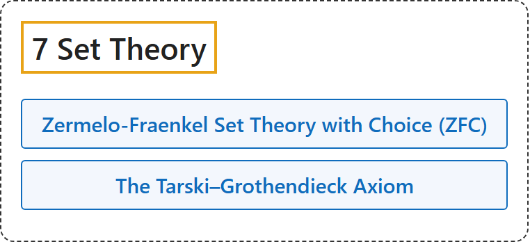

# 7 Set Theory

## Classification

## Glossary

| Term | Definition | 中文翻译 | Source |
|---|---|---|---|
| **[7 Set Theory](index.md)** 集合论 | (No definition) | （无定义） | [Megill, 2026, "The Axioms" section](https://us.metamath.org/mpeuni/mmset.html#axioms) |
| **[Zermelo-Fraenkel Set Theory with Choice (ZFC)](1-zermelo-fraenkel-set-theory-with-choice-zfc.md)** 带选择公理的策梅洛-弗兰克尔集合论（ZFC） | "**Set theory** uses the formalism of propositional and predicate calculus **to assert properties of arbitrary mathematical objects called "sets."**" | **集合论**用命题演算和谓词演算的形式体系，**来断言称为“集合”的任意数学对象的性质**。 | [Megill, 2026, "The Axioms" section](https://us.metamath.org/mpeuni/mmset.html#axioms) |
| **[The Tarski–Grothendieck Axiom](2-the-tarski-grothendieck-axiom.md)** 塔斯基-格罗滕迪克公理 | "The main important missing piece is the ability to do category theory, which requires **huge sets (inaccessible cardinals)** larger than those postulated by the ZFC axioms. The Tarski–Grothendieck Axiom **postulates the existence of such sets**." | 主要缺少的一块是做范畴论的能力，范畴论需要比 ZFC 公理所假定的更大的**巨大集合（不可达基数）**。塔斯基-格罗滕迪克公理**假定这样的集合存在**。 | [Megill, 2026, "The Axioms" section](https://us.metamath.org/mpeuni/mmset.html#axioms) |

## References

Megill, N. (2026). *Metamath Proof Explorer home page* (last updated January 19, 2026). Metamath. Retrieved October 29, 2026, from <https://us.metamath.org/mpeuni/mmset.html>
