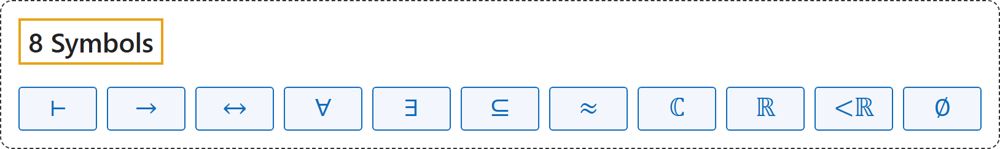

# 8 Symbols

## Classification

## Glossary

| Term | Definition | 中文翻译 | Source |
|---|---|---|---|
| **[8 Symbols](8-symbols.md)** 符号 | (No definition) | （无定义） | [Megill, 2026, "The Axioms" section](https://us.metamath.org/mpeuni/mmset.html#axioms) |
| **⊢** 可证符号（十字转门） | "The turnstile ⊢ is a symbol (introduced by Frege in 1879) used in formal logic **to indicate that the wff that follows is provable** (and is traditionally used even for an axiom, which is "provable" in one step, itself); it can be ignored for informal reading." | 十字转门 ⊢ 是一个符号（弗雷格于 1879 年引入），在形式逻辑中**表示其后的合式公式可证**（传统上公理也用它，公理一步即“可证”）；非正式阅读时可以忽略它。 | [Megill, 2026, "The Axioms" section](https://us.metamath.org/mpeuni/mmset.html#axioms) |
| **→** 蕴涵（如果……那么） | "The constants that occur in the axioms of predicate calculus are ( , ) , → , ¬ , = , ∈ , and ∀ (left parenthesis, right parenthesis, **implies**, not, equals, is a member of, for all)." | 谓词演算公理中出现的常量是 ( 、 ) 、 → 、 ¬ 、 = 、 ∈ 和 ∀（左括号、右括号、**蕴涵**、非、等于、属于、对所有）。 | [Megill, 2026, "The Axioms" section](https://us.metamath.org/mpeuni/mmset.html#axioms) |
| **↔** 当且仅当（双条件） | "( 𝜑 ↔ 𝜓 ) is **an abbreviation for (( 𝜑 → 𝜓 ) ∧ ( 𝜓 → 𝜑 ))**" | ( 𝜑 ↔ 𝜓 ) 是 **(( 𝜑 → 𝜓 ) ∧ ( 𝜓 → 𝜑 )) 的缩写** | [Megill, 2026, "The Axioms" section](https://us.metamath.org/mpeuni/mmset.html#axioms) |
| **∀** 全称量词（对所有） | "The wff ∀ 𝑥 𝜑 is read **"for all x, it is the case that phi is true."**" | 合式公式 ∀ 𝑥 𝜑 读作“**对所有 x，phi 都为真**”。 | [Megill, 2026, "The Axioms" section](https://us.metamath.org/mpeuni/mmset.html#axioms) |
| **∃** 存在量词（存在） | "∃ 𝑥 𝜑 is **an abbreviation for ¬ ∀ 𝑥 ¬ 𝜑**" | ∃ 𝑥 𝜑 是 **¬ ∀ 𝑥 ¬ 𝜑 的缩写** | [Megill, 2026, "The Axioms" section](https://us.metamath.org/mpeuni/mmset.html#axioms) |
| **⊆** 子集（包含于） | "Define **the subclass relationship**. Definition 5.9 of [TakeutiZaring] p. 17. For example, {1, 2} ⊆ {1, 2, 3}" | 定义**子类关系**。见 [TakeutiZaring] 第 17 页定义 5.9。例如 {1, 2} ⊆ {1, 2, 3} | [Megill, n.d.-a, "df-ss" page](https://us.metamath.org/mpeuni/df-ss.html) |
| **≈** 等势 | "Define **the equinumerosity relation**." | 定义**等势关系**。 | [Megill, n.d.-b, "df-en" page](https://us.metamath.org/mpeuni/df-en.html) |
| **ℂ** 复数集 | "we introduce two classes **ℂ (set of complex numbers)** and ℝ (set of real numbers)" | 我们引入两个类：**ℂ（复数集）**，以及 ℝ（实数集） | [Megill, n.d.-c, "The 22 Axioms for Complex Numbers" table](https://us.metamath.org/mpeuni/mmcomplex.html) |
| **ℝ** 实数集 | "we introduce two classes ℂ (set of complex numbers) and **ℝ (set of real numbers)**" | 我们引入两个类：ℂ（复数集）和 **ℝ（实数集）** | [Megill, n.d.-c, "The 22 Axioms for Complex Numbers" table](https://us.metamath.org/mpeuni/mmcomplex.html) |
| **<ℝ** 实数的小于 | "and one binary relation **<ℝ (less than for real numbers)**" | 以及一个二元关系 **<ℝ（实数的小于）** | [Megill, n.d.-c, "The 22 Axioms for Complex Numbers" table](https://us.metamath.org/mpeuni/mmcomplex.html) |
| **∅** 空集 | "Define **the empty set**." | 定义**空集**。 | [Megill, n.d.-d, "df-nul" page](https://us.metamath.org/mpeuni/df-nul.html) |

## References

Megill, N. (2026). *Metamath Proof Explorer home page* (last updated January 19, 2026). Metamath. Retrieved October 29, 2026, from <https://us.metamath.org/mpeuni/mmset.html>

Megill, N. (n.d.-a). *df-ss: Metamath Proof Explorer*. Metamath. Retrieved October 29, 2026, from <https://us.metamath.org/mpeuni/df-ss.html>

Megill, N. (n.d.-b). *df-en: Metamath Proof Explorer*. Metamath. Retrieved October 29, 2026, from <https://us.metamath.org/mpeuni/df-en.html>

Megill, N. (n.d.-c). *Real and complex numbers: Metamath Proof Explorer*. Metamath. Retrieved October 29, 2026, from <https://us.metamath.org/mpeuni/mmcomplex.html>

Megill, N. (n.d.-d). *df-nul: Metamath Proof Explorer*. Metamath. Retrieved October 29, 2026, from <https://us.metamath.org/mpeuni/df-nul.html>
