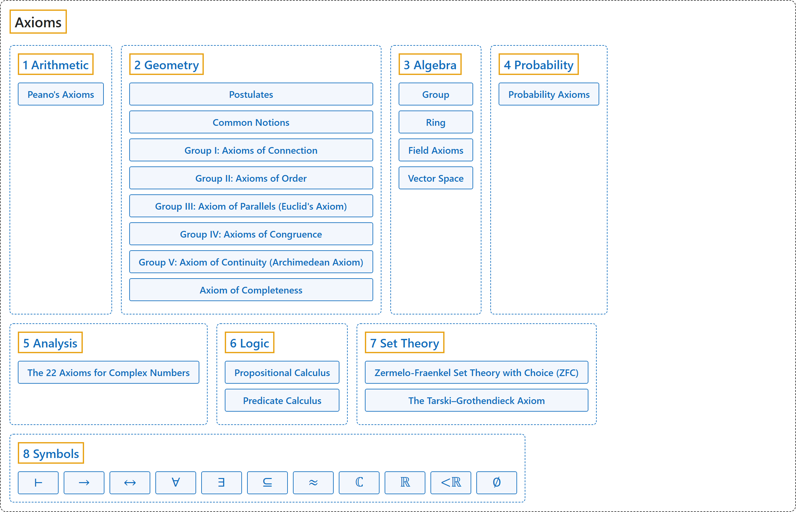

# Axioms

## Classification

## Glossary

| Term | Definition | 中文翻译 | Source |
|---|---|---|---|
| **Axioms** 公理 | "An axiom is **a fundamental assumption that provides a starting point for reasoning**." | 公理是**为推理提供起点的基本假设**。 | [Megill, 2026, "The Axioms" section](https://us.metamath.org/mpeuni/mmset.html#axioms) |
| **[1 Arithmetic](1-arithmetic.md)** 算术 | (No definition) | （无定义） | [Weisstein, n.d., "Peano's axioms" entry](https://mathworld.wolfram.com/PeanosAxioms.html) |
| **Peano's Axioms** 皮亚诺公理 | "Peano's axioms **characterize the natural numbers** as follows." | 皮亚诺公理**这样刻画自然数**： | [Weisstein, n.d., "Peano's axioms" entry](https://mathworld.wolfram.com/PeanosAxioms.html) |
| **[2 Geometry](2-geometry/index.md)** 几何 | (No definition) | （无定义） | [Euclid, ca. 300 B.C.E./1996, Book I, "Postulates"](https://mathcs.clarku.edu/~djoyce/elements/bookI/bookI.html#posts) |
| **[Postulates](2-geometry/1-postulates.md)** 公设 | (No definition) | （无定义） | [Euclid, ca. 300 B.C.E./1996, Book I, "Postulates"](https://mathcs.clarku.edu/~djoyce/elements/bookI/bookI.html#posts) |
| **[Common Notions](2-geometry/2-common-notions.md)** 公理（一般概念） | (No definition) | （无定义） | [Euclid, ca. 300 B.C.E./1996, Book I, "Common Notions"](https://mathcs.clarku.edu/~djoyce/elements/bookI/bookI.html#cns) |
| **[Group I: Axioms of Connection](2-geometry/3-group-i-axioms-of-connection.md)** 第一组：关联公理 | "The axioms of this group **establish a connection between the concepts** indicated above; namely, **points, straight lines, and planes**." | 这一组公理**在前面所说的概念之间建立联系**，即**点、直线和平面**。 | [Hilbert, 1902, § 2](https://www.gutenberg.org/ebooks/17384) |
| **[Group II: Axioms of Order](2-geometry/4-group-ii-axioms-of-order.md)** 第二组：顺序公理 | "The axioms of this group **define the idea expressed by the word "between,"** and make possible, upon the basis of this idea, **an order of sequence of the points** upon a straight line, in a plane, and in space." | 这一组公理**定义“在……之间”这个词所表达的概念**，并在此基础上，使直线上、平面上和空间中的**点有先后顺序**。 | [Hilbert, 1902, § 3](https://www.gutenberg.org/ebooks/17384) |
| **[Group III: Axiom of Parallels (Euclid's Axiom)](2-geometry/5-group-iii-axiom-of-parallels-euclid-s-axiom.md)** 第三组：平行公理（欧几里得公理） | "The introduction of this axiom **simplifies greatly the fundamental principles of geometry** and facilitates in no small degree its development." | 引入这条公理**大大简化了几何的基本原理**，并在很大程度上便利了几何的发展。 | [Hilbert, 1902, § 5](https://www.gutenberg.org/ebooks/17384) |
| **[Group IV: Axioms of Congruence](2-geometry/6-group-iv-axioms-of-congruence.md)** 第四组：合同公理 | "The axioms of this group **define the idea of congruence or displacement**." | 这一组公理**定义合同（全等）或移动的概念**。 | [Hilbert, 1902, § 6](https://www.gutenberg.org/ebooks/17384) |
| **[Group V: Axiom of Continuity (Archimedean Axiom)](2-geometry/7-group-v-axiom-of-continuity-archimedean-axiom.md)** 第五组：连续公理（阿基米德公理） | "This axiom **makes possible the introduction into geometry of the idea of continuity**." | 这条公理**使连续性的概念得以引入几何**。 | [Hilbert, 1902, § 8](https://www.gutenberg.org/ebooks/17384) |
| **[Axiom of Completeness](2-geometry/8-axiom-of-completeness.md)** 完备公理 | "To the preceeding five groups of axioms, we may add the following one, which, although **not of a purely geometrical nature**, merits particular attention from a theoretical point of view." | 在前面五组公理之外，还可以加上下面这一条，它虽然**不纯粹是几何性质的**，但从理论上看值得特别注意。 | [Hilbert, 1902, § 8](https://www.gutenberg.org/ebooks/17384) |
| **[3 Algebra](3-algebra/index.md)** 代数 | (No definition) | （无定义） | [Weisstein, n.d., "Group" entry](https://mathworld.wolfram.com/Group.html) |
| **[Group](3-algebra/1-group.md)** 群 | "A group G is a finite or infinite set of group elements together with a group operation that satisfies **the four fundamental properties of closure, associativity, the existence of an identity element, and the existence of inverse elements**." | 群 G 是由有限或无限个群元素组成的集合，连同一个群运算，满足**四条基本性质：封闭性、结合律、存在单位元、存在逆元**。 | [Weisstein, n.d., "Group" entry](https://mathworld.wolfram.com/Group.html) |
| **[Ring](3-algebra/2-ring.md)** 环 | "A ring in the mathematical sense is **a set S together with two binary operators** + and \* (commonly interpreted as addition and multiplication, respectively) satisfying the following conditions" | 数学意义上的环是**一个集合 S 连同两个二元运算** + 和 \*（通常分别解释为加法和乘法），并满足以下条件 | [Weisstein, n.d., "Ring" entry](https://mathworld.wolfram.com/Ring.html) |
| **[Field Axioms](3-algebra/3-field-axioms.md)** 域公理 | "The field axioms are **conditions on two binary operations, addition and multiplication, on a set F**." | 域公理是**对集合 F 上加法和乘法这两个二元运算的条件**。 | [Weisstein, n.d., "Field axioms" entry](https://mathworld.wolfram.com/FieldAxioms.html) |
| **[Vector Space](3-algebra/4-vector-space.md)** 向量空间 | "A vector space V is **a set equipped with vector addition and scalar multiplication** satisfying the axioms below." | 向量空间 V 是**配有向量加法和数乘的集合**，满足下列公理。 | [Weisstein, n.d., "Vector space" entry](https://mathworld.wolfram.com/VectorSpace.html) |
| **[4 Probability](4-probability.md)** 概率 | (No definition) | （无定义） | [Weisstein, n.d., "Probability axioms" entry](https://mathworld.wolfram.com/ProbabilityAxioms.html) |
| **Probability Axioms** 概率公理 | "Probability axioms state that, given an event E in a sample space S which is either finite with N elements or countably infinite with N=∞ elements, we can write S=⋃_(i=1)^N E_i, and **a quantity P(E_i), called the probability of event E_i**, is defined such that" | 概率公理说：给定样本空间 S（有限，有 N 个元素；或可数无限，N = ∞）中的事件 E，可以写成 S = ⋃ Eᵢ，并且定义一个量 P(Eᵢ)，**称为事件 Eᵢ 的概率**，使得 | [Weisstein, n.d., "Probability axioms" entry](https://mathworld.wolfram.com/ProbabilityAxioms.html) |
| **[5 Analysis](5-analysis.md)** 分析 | (No definition) | （无定义） | [Megill, n.d.-c, "The 22 Axioms for Complex Numbers" table](https://us.metamath.org/mpeuni/mmcomplex.html) |
| **The 22 Axioms for Complex Numbers** 复数的 22 条公理 | "We then assert that these eight objects have **the properties specified by the axioms in the table below, as extensions to ZFC set theory**." | 然后我们断言这八个对象具有**下表公理所规定的性质，作为 ZFC 集合论的扩充**。 | [Megill, n.d.-c, "The 22 Axioms for Complex Numbers" table](https://us.metamath.org/mpeuni/mmcomplex.html) |
| **[6 Logic](6-logic/index.md)** 逻辑 | (No definition) | （无定义） | [Megill, 2026, "The Axioms" section](https://us.metamath.org/mpeuni/mmset.html#axioms) |
| **[Propositional Calculus](6-logic/1-propositional-calculus.md)** 命题演算 | "Our system of **propositional calculus** consists of **three axioms and the modus ponens inference rule**." | 我们的**命题演算**系统由**三条公理和肯定前件推理规则**组成。 | [Megill, 2026, "The Axioms" section](https://us.metamath.org/mpeuni/mmset.html#axioms) |
| **[Predicate Calculus](6-logic/2-predicate-calculus.md)** 谓词演算 | "The axioms of **predicate calculus** express **the logical properties of these new symbols that are universally true**, independent from any theory (like set theory) making use of them." | **谓词演算**的公理表达**这些新符号普遍成立的逻辑性质**，与使用它们的任何理论（如集合论）无关。 | [Megill, 2026, "The Axioms" section](https://us.metamath.org/mpeuni/mmset.html#axioms) |
| **[7 Set Theory](7-set-theory/index.md)** 集合论 | (No definition) | （无定义） | [Megill, 2026, "The Axioms" section](https://us.metamath.org/mpeuni/mmset.html#axioms) |
| **[Zermelo-Fraenkel Set Theory with Choice (ZFC)](7-set-theory/1-zermelo-fraenkel-set-theory-with-choice-zfc.md)** 带选择公理的策梅洛-弗兰克尔集合论（ZFC） | "**Set theory** uses the formalism of propositional and predicate calculus **to assert properties of arbitrary mathematical objects called "sets."**" | **集合论**用命题演算和谓词演算的形式体系，**来断言称为“集合”的任意数学对象的性质**。 | [Megill, 2026, "The Axioms" section](https://us.metamath.org/mpeuni/mmset.html#axioms) |
| **[The Tarski–Grothendieck Axiom](7-set-theory/2-the-tarski-grothendieck-axiom.md)** 塔斯基-格罗滕迪克公理 | "The main important missing piece is the ability to do category theory, which requires **huge sets (inaccessible cardinals)** larger than those postulated by the ZFC axioms. The Tarski–Grothendieck Axiom **postulates the existence of such sets**." | 主要缺少的一块是做范畴论的能力，范畴论需要比 ZFC 公理所假定的更大的**巨大集合（不可达基数）**。塔斯基-格罗滕迪克公理**假定这样的集合存在**。 | [Megill, 2026, "The Axioms" section](https://us.metamath.org/mpeuni/mmset.html#axioms) |
| **[8 Symbols](8-symbols.md)** 符号 | (No definition) | （无定义） | [Megill, 2026, "The Axioms" section](https://us.metamath.org/mpeuni/mmset.html#axioms) |
| **⊢** 可证符号（十字转门） | "The turnstile ⊢ is a symbol (introduced by Frege in 1879) used in formal logic **to indicate that the wff that follows is provable** (and is traditionally used even for an axiom, which is "provable" in one step, itself); it can be ignored for informal reading." | 十字转门 ⊢ 是一个符号（弗雷格于 1879 年引入），在形式逻辑中**表示其后的合式公式可证**（传统上公理也用它，公理一步即“可证”）；非正式阅读时可以忽略它。 | [Megill, 2026, "The Axioms" section](https://us.metamath.org/mpeuni/mmset.html#axioms) |
| **→** 蕴涵（如果……那么） | "The constants that occur in the axioms of predicate calculus are ( , ) , → , ¬ , = , ∈ , and ∀ (left parenthesis, right parenthesis, **implies**, not, equals, is a member of, for all)." | 谓词演算公理中出现的常量是 ( 、 ) 、 → 、 ¬ 、 = 、 ∈ 和 ∀（左括号、右括号、**蕴涵**、非、等于、属于、对所有）。 | [Megill, 2026, "The Axioms" section](https://us.metamath.org/mpeuni/mmset.html#axioms) |
| **↔** 当且仅当（双条件） | "( 𝜑 ↔ 𝜓 ) is **an abbreviation for (( 𝜑 → 𝜓 ) ∧ ( 𝜓 → 𝜑 ))**" | ( 𝜑 ↔ 𝜓 ) 是 **(( 𝜑 → 𝜓 ) ∧ ( 𝜓 → 𝜑 )) 的缩写** | [Megill, 2026, "The Axioms" section](https://us.metamath.org/mpeuni/mmset.html#axioms) |
| **∀** 全称量词（对所有） | "The wff ∀ 𝑥 𝜑 is read **"for all x, it is the case that phi is true."**" | 合式公式 ∀ 𝑥 𝜑 读作“**对所有 x，phi 都为真**”。 | [Megill, 2026, "The Axioms" section](https://us.metamath.org/mpeuni/mmset.html#axioms) |
| **∃** 存在量词（存在） | "∃ 𝑥 𝜑 is **an abbreviation for ¬ ∀ 𝑥 ¬ 𝜑**" | ∃ 𝑥 𝜑 是 **¬ ∀ 𝑥 ¬ 𝜑 的缩写** | [Megill, 2026, "The Axioms" section](https://us.metamath.org/mpeuni/mmset.html#axioms) |
| **⊆** 子集（包含于） | "Define **the subclass relationship**. Definition 5.9 of [TakeutiZaring] p. 17. For example, {1, 2} ⊆ {1, 2, 3}" | 定义**子类关系**。见 [TakeutiZaring] 第 17 页定义 5.9。例如 {1, 2} ⊆ {1, 2, 3} | [Megill, n.d.-a, "df-ss" page](https://us.metamath.org/mpeuni/df-ss.html) |
| **≈** 等势 | "Define **the equinumerosity relation**." | 定义**等势关系**。 | [Megill, n.d.-b, "df-en" page](https://us.metamath.org/mpeuni/df-en.html) |
| **ℂ** 复数集 | "we introduce two classes **ℂ (set of complex numbers)** and ℝ (set of real numbers)" | 我们引入两个类：**ℂ（复数集）**，以及 ℝ（实数集） | [Megill, n.d.-c, "The 22 Axioms for Complex Numbers" table](https://us.metamath.org/mpeuni/mmcomplex.html) |
| **ℝ** 实数集 | "we introduce two classes ℂ (set of complex numbers) and **ℝ (set of real numbers)**" | 我们引入两个类：ℂ（复数集）和 **ℝ（实数集）** | [Megill, n.d.-c, "The 22 Axioms for Complex Numbers" table](https://us.metamath.org/mpeuni/mmcomplex.html) |
| **<ℝ** 实数的小于 | "and one binary relation **<ℝ (less than for real numbers)**" | 以及一个二元关系 **<ℝ（实数的小于）** | [Megill, n.d.-c, "The 22 Axioms for Complex Numbers" table](https://us.metamath.org/mpeuni/mmcomplex.html) |
| **∅** 空集 | "Define **the empty set**." | 定义**空集**。 | [Megill, n.d.-d, "df-nul" page](https://us.metamath.org/mpeuni/df-nul.html) |

## References

Euclid. (1996). *Euclid's Elements* (D. E. Joyce, Ed.; T. L. Heath, Trans.). Clark University. (Original work published ca. 300 B.C.E.) Retrieved October 29, 2026, from <https://mathcs.clarku.edu/~djoyce/elements/bookI/bookI.html>

Hilbert, D. (1902). *The foundations of geometry* (E. J. Townsend, Trans.). Open Court. Project Gutenberg. <https://www.gutenberg.org/ebooks/17384>

Megill, N. (2026). *Metamath Proof Explorer home page* (last updated January 19, 2026). Metamath. Retrieved October 29, 2026, from <https://us.metamath.org/mpeuni/mmset.html>

Megill, N. (n.d.-c). *Real and complex numbers: Metamath Proof Explorer*. Metamath. Retrieved October 29, 2026, from <https://us.metamath.org/mpeuni/mmcomplex.html>

Weisstein, E. W. (n.d.). *Field axioms*. MathWorld. Retrieved October 29, 2026, from <https://mathworld.wolfram.com/FieldAxioms.html>

Weisstein, E. W. (n.d.). *Group*. MathWorld. Retrieved October 29, 2026, from <https://mathworld.wolfram.com/Group.html>

Weisstein, E. W. (n.d.). *Peano's axioms*. MathWorld. Retrieved October 29, 2026, from <https://mathworld.wolfram.com/PeanosAxioms.html>

Weisstein, E. W. (n.d.). *Probability axioms*. MathWorld. Retrieved October 29, 2026, from <https://mathworld.wolfram.com/ProbabilityAxioms.html>

Weisstein, E. W. (n.d.). *Ring*. MathWorld. Retrieved October 29, 2026, from <https://mathworld.wolfram.com/Ring.html>

Weisstein, E. W. (n.d.). *Vector space*. MathWorld. Retrieved October 29, 2026, from <https://mathworld.wolfram.com/VectorSpace.html>
