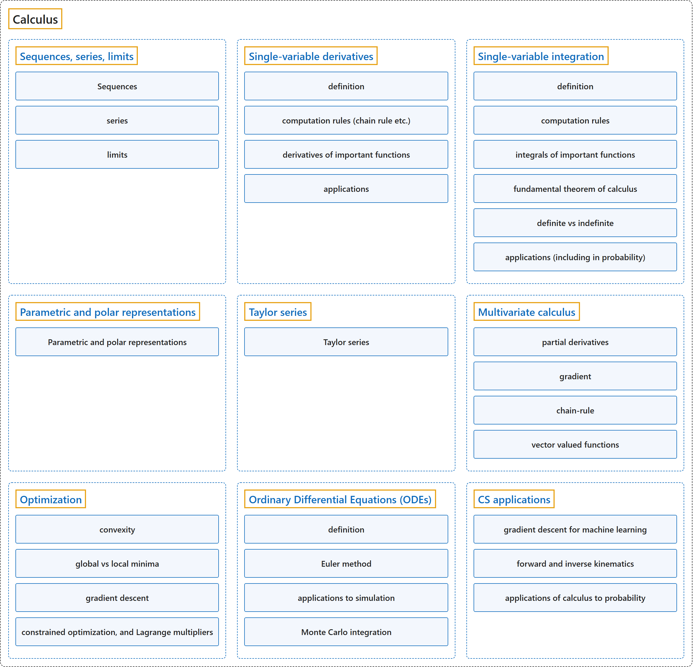

# Calculus

## Classification

## Glossary

| Term | Definition | 中文翻译 | Source |
|---|---|---|---|
| **Calculus** 微积分 | "'The' calculus, more properly called analysis (or real analysis or, in older literature, infinitesimal analysis), is the branch of mathematics studying the **rate of change of quantities** (which can be interpreted as slopes of curves) and the **length, area, and volume of objects**." | 这门微积分更恰当的名称是分析（或实分析，旧文献中称无穷小分析），是研究**量的变化率**（可解释为曲线的斜率）以及**物体的长度、面积和体积**的数学分支。 | [Weisstein, n.d.-a, "Calculus" entry, para. 2](https://mathworld.wolfram.com/Calculus.html#:~:text=is%20the%20branch%20of%20mathematics%20studying%20the%20rate%20of%20change) |
| **[Sequences, series, limits](sequences-series-limits.md)** 序列、级数、极限 | "A sequence is an **ordered set of mathematical objects**." | 序列是**数学对象的有序集合**。 | [Weisstein, n.d.-i, "Sequence" entry, para. 1](https://mathworld.wolfram.com/Sequence.html#:~:text=A%20sequence%20is%20an%20ordered%20set%20of%20mathematical%20objects) |
| **[Single-variable derivatives](single-variable-derivatives.md)** 单变量导数 | "The derivative of a function is its **instantaneous rate of change** with respect to **one of its variables**." | 函数的导数是它的**瞬时变化率**，相对于**它的某一个变量**而言。 | [Weisstein, n.d.-b, "Derivative" entry, para. 1](https://mathworld.wolfram.com/Derivative.html#:~:text=is%20its%20instantaneous%20rate%20of%20change) |
| **[Single-variable integration](single-variable-integration.md)** 单变量积分 | (context) "The most common meaning is the **fundamental object of calculus** corresponding to **summing infinitesimal pieces** to find the content of a continuous region." | （语境）最常见的含义是**微积分的基本对象**，对应于**把无穷小的部分加起来**，以求出连续区域的大小。 | [Weisstein, n.d.-d, "Integral" entry, para. 1](https://mathworld.wolfram.com/Integral.html#:~:text=The%20most%20common%20meaning%20is%20the%20fundamental%20object%20of%20calculus) |
| **[Parametric and polar representations](parametric-and-polar-representations.md)** 参数表示和极坐标表示 | "Parametric equations are a set of equations that express a set of quantities as **explicit functions** of a number of **independent variables**, known as 'parameters.'" | 参数方程是一组方程，把一组量表示成**显式函数**，函数的自变量是若干个**独立变量**，称为“参数”。 | [Weisstein, n.d.-h, "Parametric equations" entry, para. 1](https://mathworld.wolfram.com/ParametricEquations.html#:~:text=Parametric%20equations%20are%20a%20set%20of%20equations) |
| **[Taylor series](taylor-series.md)** 泰勒级数 | "A Taylor series is a **series expansion of a function** about **a point**." | 泰勒级数是**函数的级数展开**，围绕**某一点**展开。 | [Weisstein, n.d.-j, "Taylor series" entry, para. 1](https://mathworld.wolfram.com/TaylorSeries.html#:~:text=A%20Taylor%20series%20is%20a%20series%20expansion%20of%20a%20function) |
| **[Multivariate calculus](multivariate-calculus.md)** 多元微积分 | "Multivariable calculus is the branch of calculus that studies **functions of more than one variable**." | 多元微积分是微积分的一个分支，研究**多于一个变量的函数**。 | [Weisstein, n.d.-f, "Multivariable calculus" entry, para. 1](https://mathworld.wolfram.com/MultivariableCalculus.html#:~:text=studies%20functions%20of%20more%20than%20one%20variable) |
| **[Optimization](optimization.md)** 最优化 | (context) "The objective of global optimization is to find the **globally best solution** of (possibly nonlinear) models, in the (possible or known) presence of **multiple local optima**." | （语境）全局优化的目标是找到（可能是非线性的）模型的**全局最优解**，即使（可能或已知）存在**多个局部最优**。 | [Weisstein, n.d.-c, "Global optimization" entry, para. 1](https://mathworld.wolfram.com/GlobalOptimization.html#:~:text=The%20objective%20of%20global%20optimization%20is%20to%20find%20the%20globally%20best%20solution) |
| **[Ordinary Differential Equations (ODEs)](ordinary-differential-equations-odes.md)** 常微分方程（ODE） | "An ordinary differential equation (frequently called an 'ODE,' 'diff eq,' or 'diffy Q') is an **equality involving a function and its derivatives**." | 常微分方程（常称为“ODE”“diff eq”或“diffy Q”）是**含有一个函数及其导数的等式**。 | [Weisstein, n.d.-g, "Ordinary differential equation" entry, para. 1](https://mathworld.wolfram.com/OrdinaryDifferentialEquation.html#:~:text=is%20an%20equality%20involving%20a%20function%20and%20its%20derivatives) |
| **[CS applications](cs-applications.md)** 计算机科学中的应用 | (context) "The method of steepest descent is an algorithm for finding the **nearest local minimum** of a function whose **gradient** can be computed." | （语境）最速下降法是一种算法，用于寻找某个函数**最近的局部极小值**，前提是该函数的**梯度**可以计算。 | [Weisstein, n.d.-e, "Method of steepest descent" entry, para. 1](https://mathworld.wolfram.com/MethodofSteepestDescent.html#:~:text=The%20method%20of%20steepest%20descent%20is%20an%20algorithm) |

## References

- Joint Task Force on Computing Curricula. (2024). *Computer science curricula 2023*. Association for Computing Machinery. <https://doi.org/10.1145/3664191>
- Weisstein, E. W. (n.d.-a). *Calculus*. MathWorld: A Wolfram Resource. Retrieved October 27, 2026, from <https://mathworld.wolfram.com/Calculus.html>
- Weisstein, E. W. (n.d.-b). *Derivative*. MathWorld: A Wolfram Resource. Retrieved October 27, 2026, from <https://mathworld.wolfram.com/Derivative.html>
- Weisstein, E. W. (n.d.-c). *Global optimization*. MathWorld: A Wolfram Resource. Retrieved October 27, 2026, from <https://mathworld.wolfram.com/GlobalOptimization.html>
- Weisstein, E. W. (n.d.-d). *Integral*. MathWorld: A Wolfram Resource. Retrieved October 27, 2026, from <https://mathworld.wolfram.com/Integral.html>
- Weisstein, E. W. (n.d.-e). *Method of steepest descent*. MathWorld: A Wolfram Resource. Retrieved October 27, 2026, from <https://mathworld.wolfram.com/MethodofSteepestDescent.html>
- Weisstein, E. W. (n.d.-f). *Multivariable calculus*. MathWorld: A Wolfram Resource. Retrieved October 27, 2026, from <https://mathworld.wolfram.com/MultivariableCalculus.html>
- Weisstein, E. W. (n.d.-g). *Ordinary differential equation*. MathWorld: A Wolfram Resource. Retrieved October 27, 2026, from <https://mathworld.wolfram.com/OrdinaryDifferentialEquation.html>
- Weisstein, E. W. (n.d.-h). *Parametric equations*. MathWorld: A Wolfram Resource. Retrieved October 27, 2026, from <https://mathworld.wolfram.com/ParametricEquations.html>
- Weisstein, E. W. (n.d.-i). *Sequence*. MathWorld: A Wolfram Resource. Retrieved October 27, 2026, from <https://mathworld.wolfram.com/Sequence.html>
- Weisstein, E. W. (n.d.-j). *Taylor series*. MathWorld: A Wolfram Resource. Retrieved October 27, 2026, from <https://mathworld.wolfram.com/TaylorSeries.html>
