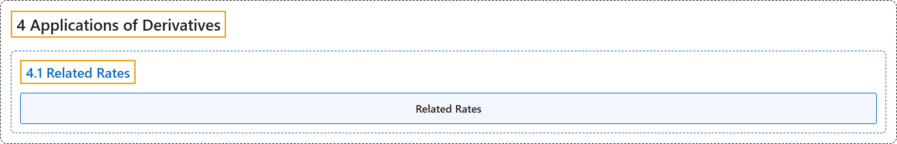

# 4.1 Related Rates

## Classification

## Glossary

| Term | Definition | 中文翻译 | Source |
|---|---|---|---|
| **4 Applications of Derivatives** 导数的应用 | (No definition) | （无定义） | [Strang & Herman, 2016a, chapter 4](https://openstax.org/books/calculus-volume-1/pages/4-introduction) |
| **4.1 Related Rates** 相关变化率 | (No definition) | （无定义） | [Strang & Herman, 2016a, section 4.1](https://openstax.org/books/calculus-volume-1/pages/4-1-related-rates) |
| **Related Rates** 相关变化率 | "are rates of change associated with **two or more related quantities** that are changing over time" | 是与**两个或更多相互关联的量**相联系的变化率，这些量都随时间变化 | [Strang & Herman, 2016a, chapter 4 Key Terms](https://openstax.org/books/calculus-volume-1/pages/4-key-terms#fs-id1165043120519) |

## References

Strang, G., & Herman, E. (2016a). *Calculus volume 1*. OpenStax. Retrieved October 29, 2026, from <https://openstax.org/details/books/calculus-volume-1>
