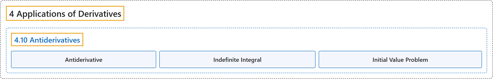

# 4.10 Antiderivatives

## Classification

## Glossary

| Term | Definition | 中文翻译 | Source |
|---|---|---|---|
| **4 Applications of Derivatives** 导数的应用 | (No definition) | （无定义） | [Strang & Herman, 2016a, chapter 4](https://openstax.org/books/calculus-volume-1/pages/4-introduction) |
| **4.10 Antiderivatives** 原函数 | (No definition) | （无定义） | [Strang & Herman, 2016a, section 4.10](https://openstax.org/books/calculus-volume-1/pages/4-10-antiderivatives) |
| **Antiderivative** 原函数 | "a function $F$ such that $F^{'}(x)=f(x)$ for all $x$ in the domain of $f$ **is an antiderivative of** $f$" | 对 $f$ 定义域中所有 $x$ 满足 $F^{'}(x)=f(x)$ 的函数 $F$ **是 $f$ 的原函数** | [Strang & Herman, 2016a, chapter 4 Key Terms](https://openstax.org/books/calculus-volume-1/pages/4-key-terms#fs-id1165042617549) |
| **Indefinite Integral** 不定积分 | "**the most general antiderivative** of $f(x)$ is the indefinite integral of $f;$ we use the notation $\int f(x)dx$ to denote the indefinite integral of $f$" | $f(x)$ 的**最一般的原函数**是 $f;$ 的不定积分；我们用记号 $\int f(x)dx$ 表示 $f$ 的不定积分 | [Strang & Herman, 2016a, chapter 4 Key Terms](https://openstax.org/books/calculus-volume-1/pages/4-key-terms#fs-id1165042617603) |
| **Initial Value Problem** 初值问题 | "a problem that requires finding a function $y$ that satisfies the differential equation $\frac{dy}{dx}=f(x)$ **together with the initial condition** $y(x_{0})=y_{0}$" | 要求找出满足微分方程 $\frac{dy}{dx}=f(x)$ **以及初始条件** $y(x_{0})=y_{0}$ 的函数 $y$ 的问题 | [Strang & Herman, 2016a, chapter 4 Key Terms](https://openstax.org/books/calculus-volume-1/pages/4-key-terms#fs-id1165042617659) |

## References

Strang, G., & Herman, E. (2016a). *Calculus volume 1*. OpenStax. Retrieved October 29, 2026, from <https://openstax.org/details/books/calculus-volume-1>
