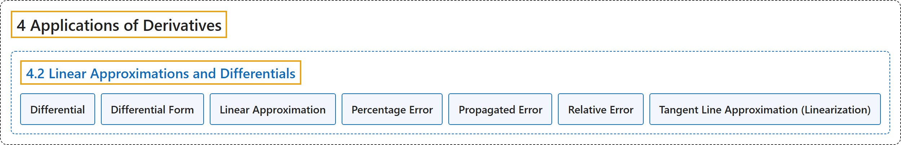

# 4.2 Linear Approximations and Differentials

## Classification

## Glossary

| Term | Definition | 中文翻译 | Source |
|---|---|---|---|
| **4 Applications of Derivatives** 导数的应用 | (No definition) | （无定义） | [Strang & Herman, 2016a, chapter 4](https://openstax.org/books/calculus-volume-1/pages/4-introduction) |
| **4.2 Linear Approximations and Differentials** 线性近似与微分 | (No definition) | （无定义） | [Strang & Herman, 2016a, section 4.2](https://openstax.org/books/calculus-volume-1/pages/4-2-linear-approximations-and-differentials) |
| **Differential** 微分 | "the differential $dx$ is **an independent variable** that can be assigned any nonzero real number; the differential $dy$ **is defined to be** $dy=f'(x)dx$" | 微分 $dx$ 是**一个自变量**，可以取任意非零实数；微分 $dy$ **定义为** $dy=f'(x)dx$ | [Strang & Herman, 2016a, chapter 4 Key Terms](https://openstax.org/books/calculus-volume-1/pages/4-key-terms#fs-id1165043099979) |
| **Differential Form** 微分形式 | "given a differentiable function $y=f'(x),$ the equation $dy=f'(x)dx$ is **the differential form of the derivative** of $y$ with respect to $x$" | 给定可导函数 $y=f'(x),$ 方程 $dy=f'(x)dx$ 是 $y$ 关于 $x$ 的**导数的微分形式** | [Strang & Herman, 2016a, chapter 4 Key Terms](https://openstax.org/books/calculus-volume-1/pages/4-key-terms#fs-id1165043199989) |
| **Linear Approximation** 线性近似 | "the linear function $L(x)=f(a)+f'(a)(x-a)$ is **the linear approximation** of $f$ at $x=a$" | 线性函数 $L(x)=f(a)+f'(a)(x-a)$ 是 $f$ 在 $x=a$ 处的**线性近似** | [Strang & Herman, 2016a, chapter 4 Key Terms](https://openstax.org/books/calculus-volume-1/pages/4-key-terms#fs-id1165043380416) |
| **Percentage Error** 百分比误差 | "**the relative error expressed as a percentage**" | **用百分数表示的相对误差** | [Strang & Herman, 2016a, chapter 4 Key Terms](https://openstax.org/books/calculus-volume-1/pages/4-key-terms#fs-id1165043257667) |
| **Propagated Error** 传播误差 | "the error that results in a calculated quantity $f(x)$ **resulting from a measurement error** dx" | 计算出的量 $f(x)$ 中**由测量误差 dx 引起**的误差 | [Strang & Herman, 2016a, chapter 4 Key Terms](https://openstax.org/books/calculus-volume-1/pages/4-key-terms#fs-id1165042478968) |
| **Relative Error** 相对误差 | "given an absolute error $\Delta q$ for a particular quantity, $\frac{\Delta q}{q}$ **is the relative error**." | 给定某个量的绝对误差 $\Delta q$，$\frac{\Delta q}{q}$ **是相对误差**。 | [Strang & Herman, 2016a, chapter 4 Key Terms](https://openstax.org/books/calculus-volume-1/pages/4-key-terms#fs-id1165042370920) |
| **Tangent Line Approximation (Linearization)** 切线近似（线性化） | "since the linear approximation of $f$ at $x=a$ is defined **using the equation of the tangent line**, the linear approximation of $f$ at $x=a$ is also known as the tangent line approximation to $f$ at $x=a$" | 由于 $f$ 在 $x=a$ 处的线性近似是**用切线方程**定义的，$f$ 在 $x=a$ 处的线性近似也称为 $f$ 在 $x=a$ 处的切线近似 | [Strang & Herman, 2016a, chapter 4 Key Terms](https://openstax.org/books/calculus-volume-1/pages/4-key-terms#fs-id1165042318986) |

## References

Strang, G., & Herman, E. (2016a). *Calculus volume 1*. OpenStax. Retrieved October 29, 2026, from <https://openstax.org/details/books/calculus-volume-1>
