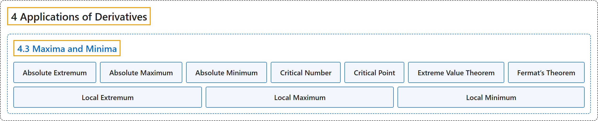

# 4.3 Maxima and Minima

## Classification

## Glossary

| Term | Definition | 中文翻译 | Source |
|---|---|---|---|
| **4 Applications of Derivatives** 导数的应用 | (No definition) | （无定义） | [Strang & Herman, 2016a, chapter 4](https://openstax.org/books/calculus-volume-1/pages/4-introduction) |
| **4.3 Maxima and Minima** 最大值与最小值 | (No definition) | （无定义） | [Strang & Herman, 2016a, section 4.3](https://openstax.org/books/calculus-volume-1/pages/4-3-maxima-and-minima) |
| **Absolute Extremum** 绝对极值 | "if $f$ has an **absolute maximum or absolute minimum** at $c,$ we say $f$ has an absolute extremum at $c$" | 若 $f$ 在 $c,$ 处有**绝对最大值或绝对最小值**，就说 $f$ 在 $c$ 处有绝对极值 | [Strang & Herman, 2016a, chapter 4 Key Terms](https://openstax.org/books/calculus-volume-1/pages/4-key-terms#fs-id1165042059050) |
| **Absolute Maximum** 绝对最大值 | "if $f(c)\ge f(x)$ **for all** $x$ in the domain of $f,$ we say $f$ has an absolute maximum at $c$" | 若**对 $f,$ 定义域中的所有** $x$ 有 $f(c)\ge f(x)$，就说 $f$ 在 $c$ 处有绝对最大值 | [Strang & Herman, 2016a, chapter 4 Key Terms](https://openstax.org/books/calculus-volume-1/pages/4-key-terms#fs-id1165042281356) |
| **Absolute Minimum** 绝对最小值 | "if $f(c)\le f(x)$ **for all** $x$ in the domain of $f,$ we say $f$ has an absolute minimum at $c$" | 若**对 $f,$ 定义域中的所有** $x$ 有 $f(c)\le f(x)$，就说 $f$ 在 $c$ 处有绝对最小值 | [Strang & Herman, 2016a, chapter 4 Key Terms](https://openstax.org/books/calculus-volume-1/pages/4-key-terms#fs-id1165042281408) |
| **Critical Number** 临界数 | "if $f'(c)=0$ or $f'(c)$ **is undefined**, we say that $c$ is a critical number of $f$" | 若 $f'(c)=0$ 或 $f'(c)$ **无定义**，就说 $c$ 是 $f$ 的临界数 | [Strang & Herman, 2016a, chapter 4 Key Terms](https://openstax.org/books/calculus-volume-1/pages/4-key-terms#fs-id1165042281462) |
| **Critical Point** 临界点 | "the point $(c\text{,}f(c))$ **a critical point** of $f$" | 点 $(c\text{,}f(c))$ 是 $f$ 的一个**临界点** | [Strang & Herman, 2016a, chapter 4 Key Terms](https://openstax.org/books/calculus-volume-1/pages/4-key-terms#fs-id11650422814622) |
| **Extreme Value Theorem** 极值定理 | "if $f$ is a continuous function over **a finite, closed interval**, then $f$ has an absolute maximum and an absolute minimum" | 若 $f$ 是**有限闭区间**上的连续函数，则 $f$ 有绝对最大值和绝对最小值 | [Strang & Herman, 2016a, chapter 4 Key Terms](https://openstax.org/books/calculus-volume-1/pages/4-key-terms#fs-id1165042281514) |
| **Fermat’s Theorem** 费马定理 | "if $f$ has **a local extremum** at $c,$ then $c$ is a critical point of $f$" | 若 $f$ 在 $c,$ 处有**局部极值**，则 $c$ 是 $f$ 的临界点 | [Strang & Herman, 2016a, chapter 4 Key Terms](https://openstax.org/books/calculus-volume-1/pages/4-key-terms#fs-id1165042281532) |
| **Local Extremum** 局部极值 | "if $f$ has a **local maximum or local minimum** at $c,$ we say $f$ has a local extremum at $c$" | 若 $f$ 在 $c,$ 处有**局部最大值或局部最小值**，就说 $f$ 在 $c$ 处有局部极值 | [Strang & Herman, 2016a, chapter 4 Key Terms](https://openstax.org/books/calculus-volume-1/pages/4-key-terms#fs-id1165042281561) |
| **Local Maximum** 局部最大值 | "if **there exists an interval** $I$ such that $f(c)\ge f(x)$ for all $x\in I,$ we say $f$ has a local maximum at $c$" | 若**存在区间** $I$ 使得对所有 $x\in I,$ 有 $f(c)\ge f(x)$，就说 $f$ 在 $c$ 处有局部最大值 | [Strang & Herman, 2016a, chapter 4 Key Terms](https://openstax.org/books/calculus-volume-1/pages/4-key-terms#fs-id1165042071370) |
| **Local Minimum** 局部最小值 | "if **there exists an interval** $I$ such that $f(c)\le f(x)$ for all $x\in I,$ we say $f$ has a local minimum at $c$" | 若**存在区间** $I$ 使得对所有 $x\in I,$ 有 $f(c)\le f(x)$，就说 $f$ 在 $c$ 处有局部最小值 | [Strang & Herman, 2016a, chapter 4 Key Terms](https://openstax.org/books/calculus-volume-1/pages/4-key-terms#fs-id1165042071428) |

## References

Strang, G., & Herman, E. (2016a). *Calculus volume 1*. OpenStax. Retrieved October 29, 2026, from <https://openstax.org/details/books/calculus-volume-1>
