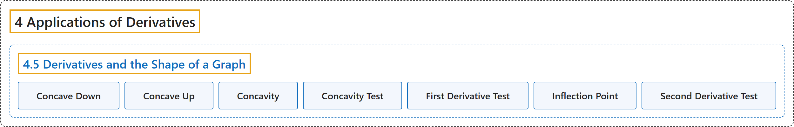

# 4.5 Derivatives and the Shape of a Graph

## Classification

## Glossary

| Term | Definition | 中文翻译 | Source |
|---|---|---|---|
| **4 Applications of Derivatives** 导数的应用 | (No definition) | （无定义） | [Strang & Herman, 2016a, chapter 4](https://openstax.org/books/calculus-volume-1/pages/4-introduction) |
| **4.5 Derivatives and the Shape of a Graph** 导数与图像的形状 | (No definition) | （无定义） | [Strang & Herman, 2016a, section 4.5](https://openstax.org/books/calculus-volume-1/pages/4-5-derivatives-and-the-shape-of-a-graph) |
| **Concave Down** 下凹 | "if $f$ is differentiable over an interval $I$ and $f^{'}$ **is decreasing over** $I,$ then $f$ is concave down over $I$" | 若 $f$ 在区间 $I$ 上可导且 $f^{'}$ 在 $I,$ 上**递减**，则 $f$ 在 $I$ 上下凹 | [Strang & Herman, 2016a, chapter 4 Key Terms](https://openstax.org/books/calculus-volume-1/pages/4-key-terms#fs-id1165043427379) |
| **Concave Up** 上凹 | "if $f$ is differentiable over an interval $I$ and $f^{'}$ **is increasing over** $I,$ then $f$ is concave up over $I$" | 若 $f$ 在区间 $I$ 上可导且 $f^{'}$ 在 $I,$ 上**递增**，则 $f$ 在 $I$ 上上凹 | [Strang & Herman, 2016a, chapter 4 Key Terms](https://openstax.org/books/calculus-volume-1/pages/4-key-terms#fs-id1165043396223) |
| **Concavity** 凹凸性 | "**the upward or downward curve** of the graph of a function" | 函数图像**向上或向下的弯曲** | [Strang & Herman, 2016a, chapter 4 Key Terms](https://openstax.org/books/calculus-volume-1/pages/4-key-terms#fs-id1165043396264) |
| **Concavity Test** 凹凸性检验 | "suppose $f$ is **twice differentiable** over an interval $I;$ if $f^{''}>0$ over $I,$ then $f$ is concave up over $I;$ if $f^{''}<0$ over $I,$ then $f$ is concave down over $I$" | 设 $f$ 在区间 $I;$ 上**二阶可导**；若在 $I,$ 上 $f^{''}>0$，则 $f$ 在 $I;$ 上上凹；若在 $I,$ 上 $f^{''}<0$，则 $f$ 在 $I$ 上下凹 | [Strang & Herman, 2016a, chapter 4 Key Terms](https://openstax.org/books/calculus-volume-1/pages/4-key-terms#fs-id1165043396274) |
| **First Derivative Test** 一阶导数检验 | "let $f$ be a continuous function over an interval $I$ containing a critical point $c$ such that $f$ is differentiable over $I$ except possibly at $c;$ if $f^{'}$ **changes sign from positive to negative** as $x$ increases through $c,$ then $f$ has a local maximum at $c;$ if $f^{'}$ **changes sign from negative to positive** as $x$ increases through $c,$ then $f$ has a local minimum at $c;$ if $f^{'}$ **does not change sign** as $x$ increases through $c,$ then $f$ does not have a local extremum at $c$" | 设 $f$ 是区间 $I$ 上的连续函数，该区间包含临界点 $c$，且 $f$ 在 $I$ 上除 $c;$ 处外都可导；若 $x$ 增大经过 $c,$ 时 $f^{'}$ **由正变负**，则 $f$ 在 $c;$ 处有局部最大值；若 $x$ 增大经过 $c,$ 时 $f^{'}$ **由负变正**，则 $f$ 在 $c;$ 处有局部最小值；若 $x$ 增大经过 $c,$ 时 $f^{'}$ **不变号**，则 $f$ 在 $c$ 处没有局部极值 | [Strang & Herman, 2016a, chapter 4 Key Terms](https://openstax.org/books/calculus-volume-1/pages/4-key-terms#fs-id1165043281605) |
| **Inflection Point** 拐点 | "if $f$ is continuous at $c$ and $f$ **changes concavity** at $c,$ the point $(c,f(c))$ is an inflection point of $f$" | 若 $f$ 在 $c$ 处连续且 $f$ 在 $c,$ 处**改变凹凸性**，点 $(c,f(c))$ 就是 $f$ 的拐点 | [Strang & Herman, 2016a, chapter 4 Key Terms](https://openstax.org/books/calculus-volume-1/pages/4-key-terms#fs-id1165042364543) |
| **Second Derivative Test** 二阶导数检验 | "suppose $f^{'}(c)=0$ and $f^{''}$ is continuous over an interval containing $c;$ if $f^{''}(c)>0,$ then $f$ has a local minimum at $c;$ if $f^{''}(c)<0,$ then $f$ has a local maximum at $c;$ if $f^{''}(c)=0,$ then **the test is inconclusive**" | 设 $f^{'}(c)=0$ 且 $f^{''}$ 在包含 $c;$ 的区间上连续；若 $f^{''}(c)>0,$ 则 $f$ 在 $c;$ 处有局部最小值；若 $f^{''}(c)<0,$ 则 $f$ 在 $c;$ 处有局部最大值；若 $f^{''}(c)=0,$ 则**检验无法判定** | [Strang & Herman, 2016a, chapter 4 Key Terms](https://openstax.org/books/calculus-volume-1/pages/4-key-terms#fs-id1165043131579) |

## References

Strang, G., & Herman, E. (2016a). *Calculus volume 1*. OpenStax. Retrieved October 29, 2026, from <https://openstax.org/details/books/calculus-volume-1>
