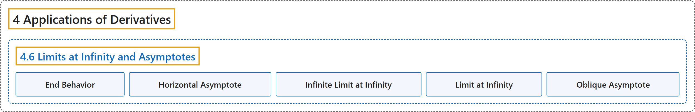

# 4.6 Limits at Infinity and Asymptotes

## Classification

## Glossary

| Term | Definition | 中文翻译 | Source |
|---|---|---|---|
| **4 Applications of Derivatives** 导数的应用 | (No definition) | （无定义） | [Strang & Herman, 2016a, chapter 4](https://openstax.org/books/calculus-volume-1/pages/4-introduction) |
| **4.6 Limits at Infinity and Asymptotes** 无穷远处的极限与渐近线 | (No definition) | （无定义） | [Strang & Herman, 2016a, section 4.6](https://openstax.org/books/calculus-volume-1/pages/4-6-limits-at-infinity-and-asymptotes) |
| **End Behavior** 端点行为 | "**the behavior of a function** as $x\to \infty$ and $x\to -\infty$" | **函数的行为**，当 $x\to \infty$ 和 $x\to -\infty$ 时 | [Strang & Herman, 2016a, chapter 4 Key Terms](https://openstax.org/books/calculus-volume-1/pages/4-key-terms#fs-id1165043208865) |
| **Horizontal Asymptote** 水平渐近线 | "if $\lim_{x\to \infty }f(x)=L$ or $\lim_{x\to -\infty }f(x)=L,$ then $y=L$ **is a horizontal asymptote** of $f$" | 若 $\lim_{x\to \infty }f(x)=L$ 或 $\lim_{x\to -\infty }f(x)=L,$ 则 $y=L$ **是 $f$ 的水平渐近线** | [Strang & Herman, 2016a, chapter 4 Key Terms](https://openstax.org/books/calculus-volume-1/pages/4-key-terms#fs-id1165043208899) |
| **Infinite Limit at Infinity** 无穷远处的无穷极限 | "a function that **becomes arbitrarily large as x becomes large**" | 当 x 变大时**变得任意大**的函数 | [Strang & Herman, 2016a, chapter 4 Key Terms](https://openstax.org/books/calculus-volume-1/pages/4-key-terms#fs-id1165042462524) |
| **Limit at Infinity** 无穷远处的极限 | "**the limiting value**, if it exists, of a function as $x\to \infty$ or $x\to -\infty$" | 函数**的极限值**（若存在），当 $x\to \infty$ 或 $x\to -\infty$ 时 | [Strang & Herman, 2016a, chapter 4 Key Terms](https://openstax.org/books/calculus-volume-1/pages/4-key-terms#fs-id1165042462539) |
| **Oblique Asymptote** 斜渐近线 | "the line $y=mx+b$ if $f(x)$ **approaches it** as $x\to \infty$ or $x\to -\infty$" | 直线 $y=mx+b$，如果 $f(x)$ 在 $x\to \infty$ 或 $x\to -\infty$ 时**趋近于它** | [Strang & Herman, 2016a, chapter 4 Key Terms](https://openstax.org/books/calculus-volume-1/pages/4-key-terms#fs-id1165042462574) |

## References

Strang, G., & Herman, E. (2016a). *Calculus volume 1*. OpenStax. Retrieved October 29, 2026, from <https://openstax.org/details/books/calculus-volume-1>
