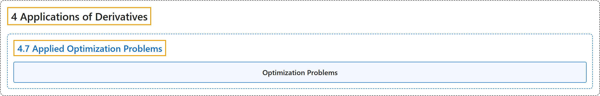

# 4.7 Applied Optimization Problems

## Classification

## Glossary

| Term | Definition | 中文翻译 | Source |
|---|---|---|---|
| **4 Applications of Derivatives** 导数的应用 | (No definition) | （无定义） | [Strang & Herman, 2016a, chapter 4](https://openstax.org/books/calculus-volume-1/pages/4-introduction) |
| **4.7 Applied Optimization Problems** 最优化应用问题 | (No definition) | （无定义） | [Strang & Herman, 2016a, section 4.7](https://openstax.org/books/calculus-volume-1/pages/4-7-applied-optimization-problems) |
| **Optimization Problems** 最优化问题 | "problems that are solved by **finding the maximum or minimum value of a function**" | 通过**求函数的最大值或最小值**来解决的问题 | [Strang & Herman, 2016a, chapter 4 Key Terms](https://openstax.org/books/calculus-volume-1/pages/4-key-terms#fs-id1165043323724) |

## References

Strang, G., & Herman, E. (2016a). *Calculus volume 1*. OpenStax. Retrieved October 29, 2026, from <https://openstax.org/details/books/calculus-volume-1>
