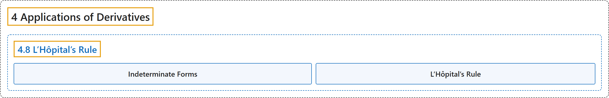

# 4.8 L’Hôpital’s Rule

## Classification

## Glossary

| Term | Definition | 中文翻译 | Source |
|---|---|---|---|
| **4 Applications of Derivatives** 导数的应用 | (No definition) | （无定义） | [Strang & Herman, 2016a, chapter 4](https://openstax.org/books/calculus-volume-1/pages/4-introduction) |
| **4.8 L’Hôpital’s Rule** 洛必达法则 | (No definition) | （无定义） | [Strang & Herman, 2016a, section 4.8](https://openstax.org/books/calculus-volume-1/pages/4-8-lhopitals-rule) |
| **Indeterminate Forms** 不定式 | "when evaluating a limit, the forms $\frac{0}{0},$ $\infty /\infty ,$ $0\cdot \infty ,$ $\infty -\infty ,$ $0^{0},$ ${\infty }^{0},$ and $1^{\infty }$ are considered indeterminate because **further analysis is required** to determine whether the limit exists and, if so, what its value is" | 求极限时，形式 $\frac{0}{0},$ $\infty /\infty ,$ $0\cdot \infty ,$ $\infty -\infty ,$ $0^{0},$ ${\infty }^{0},$ 和 $1^{\infty }$ 被视为不定的，因为**需要进一步分析**才能确定极限是否存在以及若存在其值是多少 | [Strang & Herman, 2016a, chapter 4 Key Terms](https://openstax.org/books/calculus-volume-1/pages/4-key-terms#fs-id1165042539157) |
| **L’Hôpital’s Rule** 洛必达法则 | "if $f$ and $g$ are differentiable functions over an interval $a,$ except possibly at $a,$ and $\lim_{x\to a}f(x)=0=\lim_{x\to a}g(x)$ or $\lim_{x\to a}f(x)$ and $\lim_{x\to a}g(x)$ are infinite, then $\lim_{x\to a}\frac{f(x)}{g(x)}=\lim_{x\to a}\frac{f^{'}(x)}{g^{'}(x)},$ **assuming the limit on the right exists** or is $\infty$ or $-\infty$" | 若 $f$ 和 $g$ 是在区间 $a,$ 上（可能除 $a,$ 外）可导的函数，且 $\lim_{x\to a}f(x)=0=\lim_{x\to a}g(x)$ 或 $\lim_{x\to a}f(x)$ 与 $\lim_{x\to a}g(x)$ 都是无穷，则 $\lim_{x\to a}\frac{f(x)}{g(x)}=\lim_{x\to a}\frac{f^{'}(x)}{g^{'}(x)},$ **前提是右边的极限存在**或为 $\infty$ 或 $-\infty$ | [Strang & Herman, 2016a, chapter 4 Key Terms](https://openstax.org/books/calculus-volume-1/pages/4-key-terms#fs-id1165042539243) |

## References

Strang, G., & Herman, E. (2016a). *Calculus volume 1*. OpenStax. Retrieved October 29, 2026, from <https://openstax.org/details/books/calculus-volume-1>
