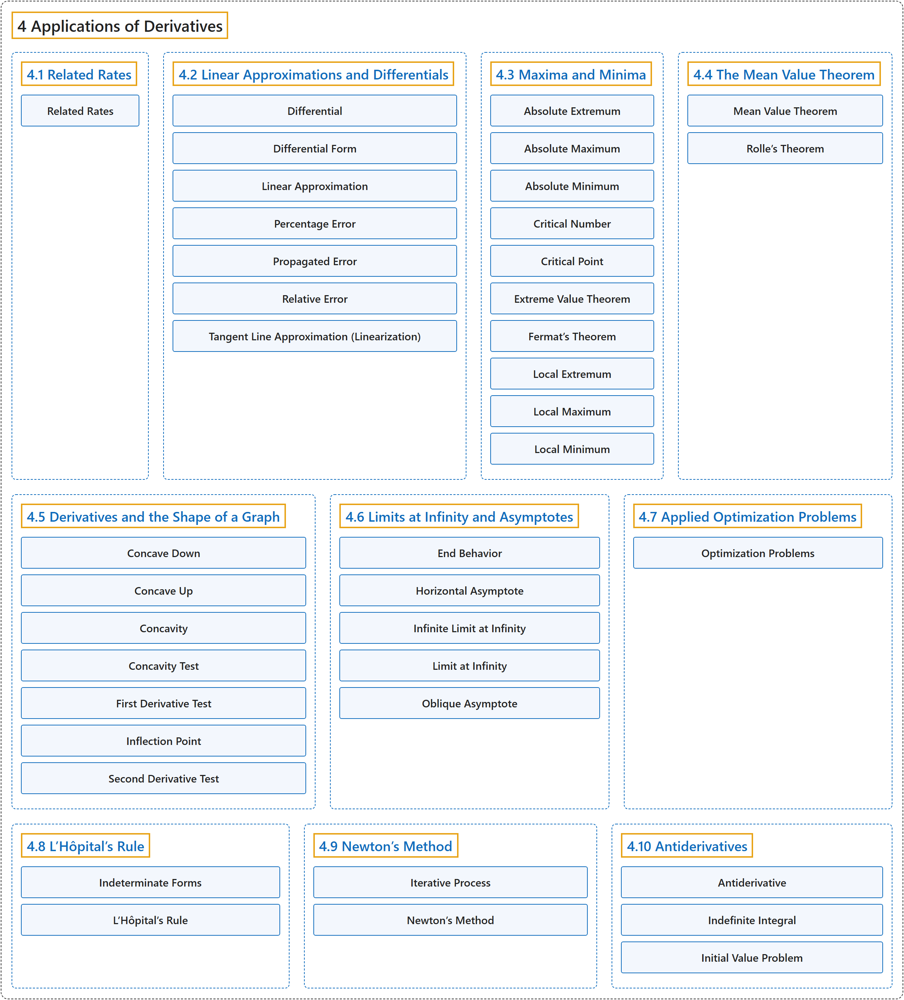

# 4 Applications of Derivatives

## Classification

## Glossary

| Term | Definition | 中文翻译 | Source |
|---|---|---|---|
| **4 Applications of Derivatives** 导数的应用 | (No definition) | （无定义） | [Strang & Herman, 2016a, chapter 4](https://openstax.org/books/calculus-volume-1/pages/4-introduction) |
| **[4.1 Related Rates](4-1-related-rates.md)** 相关变化率 | (No definition) | （无定义） | [Strang & Herman, 2016a, section 4.1](https://openstax.org/books/calculus-volume-1/pages/4-1-related-rates) |
| **[4.2 Linear Approximations and Differentials](4-2-linear-approximations-and-differentials.md)** 线性近似与微分 | (No definition) | （无定义） | [Strang & Herman, 2016a, section 4.2](https://openstax.org/books/calculus-volume-1/pages/4-2-linear-approximations-and-differentials) |
| **[4.3 Maxima and Minima](4-3-maxima-and-minima.md)** 最大值与最小值 | (No definition) | （无定义） | [Strang & Herman, 2016a, section 4.3](https://openstax.org/books/calculus-volume-1/pages/4-3-maxima-and-minima) |
| **[4.4 The Mean Value Theorem](4-4-the-mean-value-theorem.md)** 中值定理 | (No definition) | （无定义） | [Strang & Herman, 2016a, section 4.4](https://openstax.org/books/calculus-volume-1/pages/4-4-the-mean-value-theorem) |
| **[4.5 Derivatives and the Shape of a Graph](4-5-derivatives-and-the-shape-of-a-graph.md)** 导数与图像的形状 | (No definition) | （无定义） | [Strang & Herman, 2016a, section 4.5](https://openstax.org/books/calculus-volume-1/pages/4-5-derivatives-and-the-shape-of-a-graph) |
| **[4.6 Limits at Infinity and Asymptotes](4-6-limits-at-infinity-and-asymptotes.md)** 无穷远处的极限与渐近线 | (No definition) | （无定义） | [Strang & Herman, 2016a, section 4.6](https://openstax.org/books/calculus-volume-1/pages/4-6-limits-at-infinity-and-asymptotes) |
| **[4.7 Applied Optimization Problems](4-7-applied-optimization-problems.md)** 最优化应用问题 | (No definition) | （无定义） | [Strang & Herman, 2016a, section 4.7](https://openstax.org/books/calculus-volume-1/pages/4-7-applied-optimization-problems) |
| **[4.8 L’Hôpital’s Rule](4-8-lh-pitals-rule.md)** 洛必达法则 | (No definition) | （无定义） | [Strang & Herman, 2016a, section 4.8](https://openstax.org/books/calculus-volume-1/pages/4-8-lhopitals-rule) |
| **[4.9 Newton’s Method](4-9-newtons-method.md)** 牛顿法 | (No definition) | （无定义） | [Strang & Herman, 2016a, section 4.9](https://openstax.org/books/calculus-volume-1/pages/4-9-newtons-method) |
| **[4.10 Antiderivatives](4-10-antiderivatives.md)** 原函数 | (No definition) | （无定义） | [Strang & Herman, 2016a, section 4.10](https://openstax.org/books/calculus-volume-1/pages/4-10-antiderivatives) |

## References

Strang, G., & Herman, E. (2016a). *Calculus volume 1*. OpenStax. Retrieved October 29, 2026, from <https://openstax.org/details/books/calculus-volume-1>
