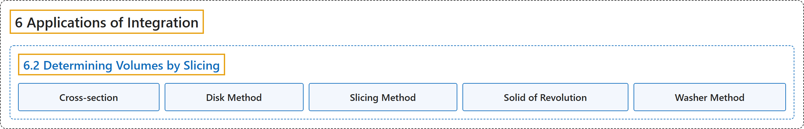

# 6.2 Determining Volumes by Slicing

## Classification

## Glossary

| Term | Definition | 中文翻译 | Source |
|---|---|---|---|
| **6 Applications of Integration** 积分的应用 | (No definition) | （无定义） | [Strang & Herman, 2016a, chapter 6](https://openstax.org/books/calculus-volume-1/pages/6-introduction) |
| **6.2 Determining Volumes by Slicing** 用切片法求体积 | (No definition) | （无定义） | [Strang & Herman, 2016a, section 6.2](https://openstax.org/books/calculus-volume-1/pages/6-2-determining-volumes-by-slicing) |
| **Cross-section** 截面 | "**the intersection of a plane and a solid object**" | **平面与立体的交** | [Strang & Herman, 2016a, chapter 6 Key Terms](https://openstax.org/books/calculus-volume-1/pages/6-key-terms#fs-id1167794199239) |
| **Disk Method** 圆盘法 | "a special case of the slicing method used with solids of revolution when **the slices are disks**" | 切片法用于旋转体的特例，此时**切片是圆盘** | [Strang & Herman, 2016a, chapter 6 Key Terms](https://openstax.org/books/calculus-volume-1/pages/6-key-terms#fs-id1167794199249) |
| **Slicing Method** 切片法 | "a method of calculating the volume of a solid that involves **cutting the solid into pieces**, estimating the volume of each piece, then adding these estimates to arrive at an estimate of the total volume; as the number of slices goes to infinity, this estimate becomes an integral that gives the exact value of the volume" | 计算立体体积的一种方法：**把立体切成小块**，估计每块的体积，再把这些估计加起来得到总体积的估计；切片数趋于无穷时，这个估计变成给出体积精确值的积分 | [Strang & Herman, 2016a, chapter 6 Key Terms](https://openstax.org/books/calculus-volume-1/pages/6-key-terms#fs-id1167794199259) |
| **Solid of Revolution** 旋转体 | "a solid generated by **revolving a region in a plane around a line** in that plane" | **平面区域绕该平面内一条直线旋转**所生成的立体 | [Strang & Herman, 2016a, chapter 6 Key Terms](https://openstax.org/books/calculus-volume-1/pages/6-key-terms#fs-id1167793368725) |
| **Washer Method** 垫圈法 | "a special case of the slicing method used with solids of revolution when **the slices are washers**" | 切片法用于旋转体的特例，此时**切片是垫圈** | [Strang & Herman, 2016a, chapter 6 Key Terms](https://openstax.org/books/calculus-volume-1/pages/6-key-terms#fs-id1167793368735) |

## References

Strang, G., & Herman, E. (2016a). *Calculus volume 1*. OpenStax. Retrieved October 29, 2026, from <https://openstax.org/details/books/calculus-volume-1>
