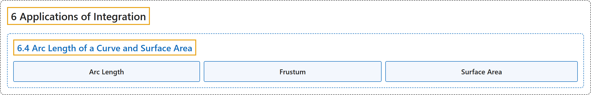

# 6.4 Arc Length of a Curve and Surface Area

## Classification

## Glossary

| Term | Definition | 中文翻译 | Source |
|---|---|---|---|
| **6 Applications of Integration** 积分的应用 | (No definition) | （无定义） | [Strang & Herman, 2016a, chapter 6](https://openstax.org/books/calculus-volume-1/pages/6-introduction) |
| **6.4 Arc Length of a Curve and Surface Area** 曲线的弧长与表面积 | (No definition) | （无定义） | [Strang & Herman, 2016a, section 6.4](https://openstax.org/books/calculus-volume-1/pages/6-4-arc-length-of-a-curve-and-surface-area) |
| **Arc Length** 弧长 | "the arc length of a curve can be thought of as **the distance a person would travel along the path of the curve**" | 曲线的弧长可以看作**人沿曲线路径行走的距离** | [Strang & Herman, 2016a, chapter 6 Key Terms](https://openstax.org/books/calculus-volume-1/pages/6-key-terms#fs-id1167793720071) |
| **Frustum** 平截头体 | "**a portion of a cone**; a frustum is constructed by cutting the cone with a plane parallel to the base" | **圆锥的一部分**；用平行于底面的平面截圆锥就得到平截头体 | [Strang & Herman, 2016a, chapter 6 Key Terms](https://openstax.org/books/calculus-volume-1/pages/6-key-terms#fs-id1167793455097) |
| **Surface Area** 表面积 | "the surface area of a solid is **the total area of the outer layer of the object**; for objects such as cubes or bricks, the surface area of the object is the sum of the areas of all of its faces" | 立体的表面积是**物体外层的总面积**；对立方体或砖块这样的物体，表面积是它所有面的面积之和 | [Strang & Herman, 2016a, chapter 6 Key Terms](https://openstax.org/books/calculus-volume-1/pages/6-key-terms#fs-id1167793455108) |

## References

Strang, G., & Herman, E. (2016a). *Calculus volume 1*. OpenStax. Retrieved October 29, 2026, from <https://openstax.org/details/books/calculus-volume-1>
