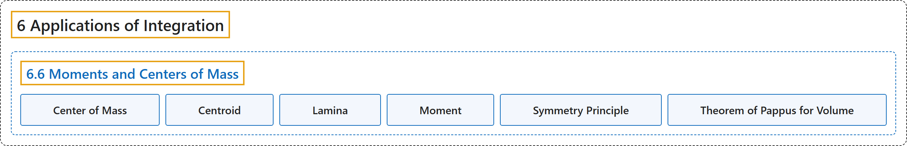

# 6.6 Moments and Centers of Mass

## Classification

## Glossary

| Term | Definition | 中文翻译 | Source |
|---|---|---|---|
| **6 Applications of Integration** 积分的应用 | (No definition) | （无定义） | [Strang & Herman, 2016a, chapter 6](https://openstax.org/books/calculus-volume-1/pages/6-introduction) |
| **6.6 Moments and Centers of Mass** 矩与质心 | (No definition) | （无定义） | [Strang & Herman, 2016a, section 6.6](https://openstax.org/books/calculus-volume-1/pages/6-6-moments-and-centers-of-mass) |
| **Center of Mass** 质心 | "the point at which the total mass of the system could be concentrated **without changing the moment**" | 系统的总质量可以集中于此**而不改变力矩**的点 | [Strang & Herman, 2016a, chapter 6 Key Terms](https://openstax.org/books/calculus-volume-1/pages/6-key-terms#fs-id1167793274890) |
| **Centroid** 形心 | "the centroid of a region is **the geometric center of the region**; laminas are often represented by regions in the plane; if the lamina has a constant density, the center of mass of the lamina depends only on the shape of the corresponding planar region; in this case, the center of mass of the lamina corresponds to the centroid of the representative region" | 区域的形心是**区域的几何中心**；薄片常用平面上的区域表示；若薄片密度恒定，薄片的质心只取决于对应平面区域的形状；此时薄片的质心与代表区域的形心重合 | [Strang & Herman, 2016a, chapter 6 Key Terms](https://openstax.org/books/calculus-volume-1/pages/6-key-terms#fs-id1167793274901) |
| **Lamina** 薄片 | "**a thin sheet of material**; laminas are thin enough that, for mathematical purposes, they can be treated as if they are two-dimensional" | **一层很薄的材料**；薄片薄到在数学上可以当作二维对象处理 | [Strang & Herman, 2016a, chapter 6 Key Terms](https://openstax.org/books/calculus-volume-1/pages/6-key-terms#fs-id1167793274914) |
| **Moment** 矩 | "if n masses are arranged on a number line, **the moment of the system with respect to the origin** is given by $M=\sum_{i=1}^{n}m_{i}x_{i};$ if, instead, we consider a region in the plane, bounded above by a function $f(x)$ over an interval $[a,b],$ then the moments of the region with respect to the x- and y-axes are given by $M_{x}=\rho {\int }_{a}^{b}\frac{{[f(x)]}^{2}}{2}dx$ and $M_{y}=\rho {\int }_{a}^{b}xf(x)dx,$ respectively" | 若 n 个质量排在数轴上，**系统关于原点的矩**为 $M=\sum_{i=1}^{n}m_{i}x_{i};$ 若改为考虑平面上的区域，上方由区间 $[a,b],$ 上的函数 $f(x)$ 围成，则区域关于 x 轴和 y 轴的矩分别为 $M_{x}=\rho {\int }_{a}^{b}\frac{{[f(x)]}^{2}}{2}dx$ 和 $M_{y}=\rho {\int }_{a}^{b}xf(x)dx,$ | [Strang & Herman, 2016a, chapter 6 Key Terms](https://openstax.org/books/calculus-volume-1/pages/6-key-terms#fs-id1167793280349) |
| **Symmetry Principle** 对称原理 | "the symmetry principle states that if a region R is symmetric about a line l, then **the centroid of R lies on l**" | 对称原理指出，若区域 R 关于直线 l 对称，则 **R 的形心在 l 上** | [Strang & Herman, 2016a, chapter 6 Key Terms](https://openstax.org/books/calculus-volume-1/pages/6-key-terms#fs-id1167793630122) |
| **Theorem of Pappus for Volume** 帕普斯体积定理 | "this theorem states that the volume of a solid of revolution formed by revolving a region around an external axis is equal to **the area of the region multiplied by the distance traveled by the centroid of the region**" | 这条定理指出，区域绕外部轴旋转所成旋转体的体积，等于**区域面积乘以区域形心经过的距离** | [Strang & Herman, 2016a, chapter 6 Key Terms](https://openstax.org/books/calculus-volume-1/pages/6-key-terms#fs-id1167793630152) |

## References

Strang, G., & Herman, E. (2016a). *Calculus volume 1*. OpenStax. Retrieved October 29, 2026, from <https://openstax.org/details/books/calculus-volume-1>
