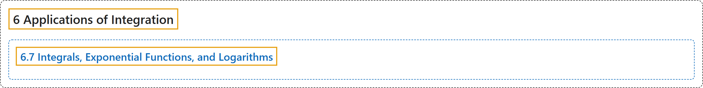

# 6.7 Integrals, Exponential Functions, and Logarithms

## Classification

## Glossary

| Term | Definition | 中文翻译 | Source |
|---|---|---|---|
| **6 Applications of Integration** 积分的应用 | (No definition) | （无定义） | [Strang & Herman, 2016a, chapter 6](https://openstax.org/books/calculus-volume-1/pages/6-introduction) |
| **6.7 Integrals, Exponential Functions, and Logarithms** 积分、指数函数与对数 | (No definition) | （无定义） | [Strang & Herman, 2016a, section 6.7](https://openstax.org/books/calculus-volume-1/pages/6-7-integrals-exponential-functions-and-logarithms) |

## References

Strang, G., & Herman, E. (2016a). *Calculus volume 1*. OpenStax. Retrieved October 29, 2026, from <https://openstax.org/details/books/calculus-volume-1>
