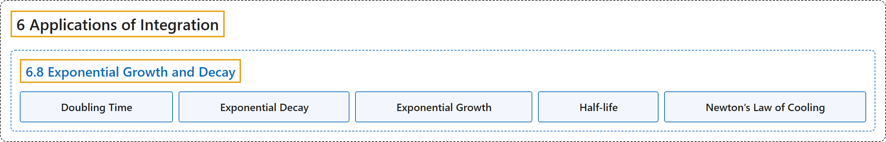

# 6.8 Exponential Growth and Decay

## Classification

## Glossary

| Term | Definition | 中文翻译 | Source |
|---|---|---|---|
| **6 Applications of Integration** 积分的应用 | (No definition) | （无定义） | [Strang & Herman, 2016a, chapter 6](https://openstax.org/books/calculus-volume-1/pages/6-introduction) |
| **6.8 Exponential Growth and Decay** 指数增长与衰减 | (No definition) | （无定义） | [Strang & Herman, 2016a, section 6.8](https://openstax.org/books/calculus-volume-1/pages/6-8-exponential-growth-and-decay) |
| **Doubling Time** 倍增时间 | "if a quantity grows exponentially, the doubling time is **the amount of time it takes the quantity to double**, and is given by $(\ln \,2)/k$" | 若一个量呈指数增长，倍增时间是**这个量翻倍所需的时间**，由 $(\ln \,2)/k$ 给出 | [Strang & Herman, 2016a, chapter 6 Key Terms](https://openstax.org/books/calculus-volume-1/pages/6-key-terms#fs-id1167793423300) |
| **Exponential Decay** 指数衰减 | "systems that exhibit exponential decay **follow a model of the form** $y=y_{0}e^{-kt}$" | 呈指数衰减的系统**遵循形如 $y=y_{0}e^{-kt}$ 的模型** | [Strang & Herman, 2016a, chapter 6 Key Terms](https://openstax.org/books/calculus-volume-1/pages/6-key-terms#fs-id1167794146802) |
| **Exponential Growth** 指数增长 | "systems that exhibit exponential growth **follow a model of the form** $y=y_{0}e^{kt}$" | 呈指数增长的系统**遵循形如 $y=y_{0}e^{kt}$ 的模型** | [Strang & Herman, 2016a, chapter 6 Key Terms](https://openstax.org/books/calculus-volume-1/pages/6-key-terms#fs-id1167794146834) |
| **Half-life** 半衰期 | "if a quantity decays exponentially, the half-life is **the amount of time it takes the quantity to be reduced by half**. It is given by $(\ln \,2)/k$" | 若一个量呈指数衰减，半衰期是**这个量减少一半所需的时间**。它由 $(\ln \,2)/k$ 给出 | [Strang & Herman, 2016a, chapter 6 Key Terms](https://openstax.org/books/calculus-volume-1/pages/6-key-terms#fs-id1167793541831) |
| **Newton’s Law of Cooling** 牛顿冷却定律 | "Newton’s law of cooling says that an object cools at **a rate proportional to the difference** between the temperature of the object and the temperature of the surroundings." | 牛顿冷却定律指出，物体冷却的速率**与物体温度和周围温度之差成正比**。 | [Strang & Herman, 2016a, section 6.8](https://openstax.org/books/calculus-volume-1/pages/6-8-exponential-growth-and-decay#term-00007) |

## References

Strang, G., & Herman, E. (2016a). *Calculus volume 1*. OpenStax. Retrieved October 29, 2026, from <https://openstax.org/details/books/calculus-volume-1>
