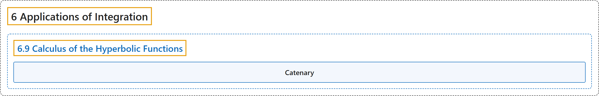

# 6.9 Calculus of the Hyperbolic Functions

## Classification

## Glossary

| Term | Definition | 中文翻译 | Source |
|---|---|---|---|
| **6 Applications of Integration** 积分的应用 | (No definition) | （无定义） | [Strang & Herman, 2016a, chapter 6](https://openstax.org/books/calculus-volume-1/pages/6-introduction) |
| **6.9 Calculus of the Hyperbolic Functions** 双曲函数的微积分 | (No definition) | （无定义） | [Strang & Herman, 2016a, section 6.9](https://openstax.org/books/calculus-volume-1/pages/6-9-calculus-of-the-hyperbolic-functions) |
| **Catenary** 悬链线 | "a curve in the shape of the function $y=a\,\cosh (x/a)$ is a catenary; **a cable of uniform density suspended between two supports** assumes the shape of a catenary" | 形如函数 $y=a\,\cosh (x/a)$ 的曲线是悬链线；**挂在两个支点之间的均匀密度的缆绳**呈悬链线形状 | [Strang & Herman, 2016a, chapter 6 Key Terms](https://openstax.org/books/calculus-volume-1/pages/6-key-terms#fs-id1167793432037) |

## References

Strang, G., & Herman, E. (2016a). *Calculus volume 1*. OpenStax. Retrieved October 29, 2026, from <https://openstax.org/details/books/calculus-volume-1>
