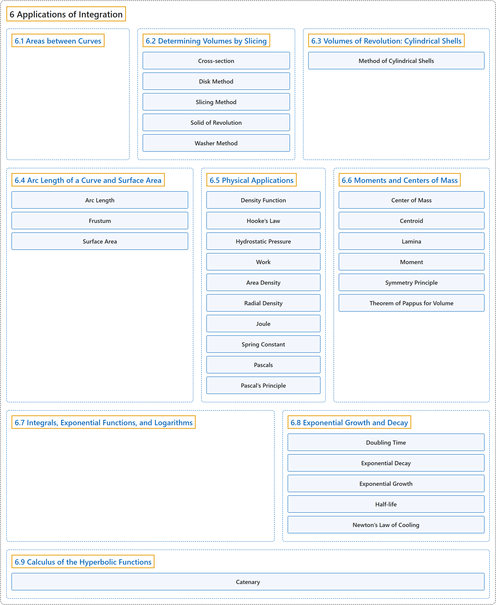

# 6 Applications of Integration

## Classification

## Glossary

| Term | Definition | 中文翻译 | Source |
|---|---|---|---|
| **6 Applications of Integration** 积分的应用 | (No definition) | （无定义） | [Strang & Herman, 2016a, chapter 6](https://openstax.org/books/calculus-volume-1/pages/6-introduction) |
| **[6.1 Areas between Curves](6-1-areas-between-curves.md)** 曲线之间的面积 | (No definition) | （无定义） | [Strang & Herman, 2016a, section 6.1](https://openstax.org/books/calculus-volume-1/pages/6-1-areas-between-curves) |
| **[6.2 Determining Volumes by Slicing](6-2-determining-volumes-by-slicing.md)** 用切片法求体积 | (No definition) | （无定义） | [Strang & Herman, 2016a, section 6.2](https://openstax.org/books/calculus-volume-1/pages/6-2-determining-volumes-by-slicing) |
| **[6.3 Volumes of Revolution: Cylindrical Shells](6-3-volumes-of-revolution-cylindrical-shells.md)** 旋转体的体积：柱壳法 | (No definition) | （无定义） | [Strang & Herman, 2016a, section 6.3](https://openstax.org/books/calculus-volume-1/pages/6-3-volumes-of-revolution-cylindrical-shells) |
| **[6.4 Arc Length of a Curve and Surface Area](6-4-arc-length-of-a-curve-and-surface-area.md)** 曲线的弧长与表面积 | (No definition) | （无定义） | [Strang & Herman, 2016a, section 6.4](https://openstax.org/books/calculus-volume-1/pages/6-4-arc-length-of-a-curve-and-surface-area) |
| **[6.5 Physical Applications](6-5-physical-applications.md)** 物理应用 | (No definition) | （无定义） | [Strang & Herman, 2016a, section 6.5](https://openstax.org/books/calculus-volume-1/pages/6-5-physical-applications) |
| **[6.6 Moments and Centers of Mass](6-6-moments-and-centers-of-mass.md)** 矩与质心 | (No definition) | （无定义） | [Strang & Herman, 2016a, section 6.6](https://openstax.org/books/calculus-volume-1/pages/6-6-moments-and-centers-of-mass) |
| **[6.7 Integrals, Exponential Functions, and Logarithms](6-7-integrals-exponential-functions-and-logarithms.md)** 积分、指数函数与对数 | (No definition) | （无定义） | [Strang & Herman, 2016a, section 6.7](https://openstax.org/books/calculus-volume-1/pages/6-7-integrals-exponential-functions-and-logarithms) |
| **[6.8 Exponential Growth and Decay](6-8-exponential-growth-and-decay.md)** 指数增长与衰减 | (No definition) | （无定义） | [Strang & Herman, 2016a, section 6.8](https://openstax.org/books/calculus-volume-1/pages/6-8-exponential-growth-and-decay) |
| **[6.9 Calculus of the Hyperbolic Functions](6-9-calculus-of-the-hyperbolic-functions.md)** 双曲函数的微积分 | (No definition) | （无定义） | [Strang & Herman, 2016a, section 6.9](https://openstax.org/books/calculus-volume-1/pages/6-9-calculus-of-the-hyperbolic-functions) |

## References

Strang, G., & Herman, E. (2016a). *Calculus volume 1*. OpenStax. Retrieved October 29, 2026, from <https://openstax.org/details/books/calculus-volume-1>
