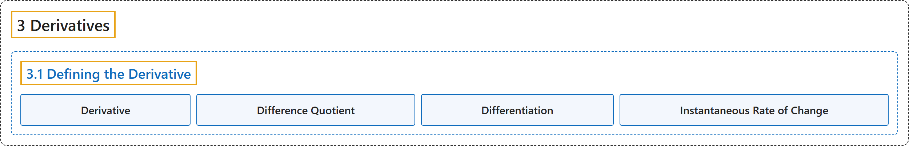

# 3.1 Defining the Derivative

## Classification

## Glossary

| Term | Definition | 中文翻译 | Source |
|---|---|---|---|
| **3 Derivatives** 导数 | (No definition) | （无定义） | [Strang & Herman, 2016a, chapter 3](https://openstax.org/books/calculus-volume-1/pages/3-introduction) |
| **3.1 Defining the Derivative** 导数的定义 | (No definition) | （无定义） | [Strang & Herman, 2016a, section 3.1](https://openstax.org/books/calculus-volume-1/pages/3-1-defining-the-derivative) |
| **Derivative** 导数 | "**the slope of the tangent line** to a function at a point, calculated by taking **the limit of the difference quotient**, is the derivative" | 函数在某点处**切线的斜率**，通过取**差商的极限**算出，就是导数 | [Strang & Herman, 2016a, chapter 3 Key Terms](https://openstax.org/books/calculus-volume-1/pages/3-key-terms#fs-id1169739111084) |
| **Difference Quotient** 差商 | "of a function $f(x)$ at $a$ **is given by** $\frac{f(a+h)-f(a)}{h}\,\text{or}\,\frac{f(x)-f(a)}{x-a}$" | 函数 $f(x)$ 在 $a$ 处的差商**由 $\frac{f(a+h)-f(a)}{h}\,\text{or}\,\frac{f(x)-f(a)}{x-a}$ 给出** | [Strang & Herman, 2016a, chapter 3 Key Terms](https://openstax.org/books/calculus-volume-1/pages/3-key-terms#fs-id1169739111095) |
| **Differentiation** 求导 | "the process of **taking a derivative**" | **求导数**的过程 | [Strang & Herman, 2016a, chapter 3 Key Terms](https://openstax.org/books/calculus-volume-1/pages/3-key-terms#fs-id1169739111206) |
| **Instantaneous Rate of Change** 瞬时变化率 | "**the rate of change of a function at any point** along the function $a,$ also called $f^{'}(a),$ or the derivative of the function at $a$" | **函数在任一点处的变化率**，沿函数在点 $a,$ 处，也称为 $f^{'}(a),$ 或函数在 $a$ 处的导数 | [Strang & Herman, 2016a, chapter 3 Key Terms](https://openstax.org/books/calculus-volume-1/pages/3-key-terms#fs-id1169739111216) |

## References

Strang, G., & Herman, E. (2016a). *Calculus volume 1*. OpenStax. Retrieved October 29, 2026, from <https://openstax.org/details/books/calculus-volume-1>
