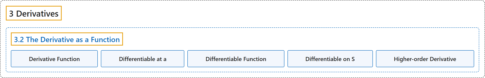

# 3.2 The Derivative as a Function

## Classification

## Glossary

| Term | Definition | 中文翻译 | Source |
|---|---|---|---|
| **3 Derivatives** 导数 | (No definition) | （无定义） | [Strang & Herman, 2016a, chapter 3](https://openstax.org/books/calculus-volume-1/pages/3-introduction) |
| **3.2 The Derivative as a Function** 作为函数的导数 | (No definition) | （无定义） | [Strang & Herman, 2016a, section 3.2](https://openstax.org/books/calculus-volume-1/pages/3-2-the-derivative-as-a-function) |
| **Derivative Function** 导函数 | "gives **the derivative of a function at each point** in the domain of the original function for which the derivative is defined" | 给出**函数在每一点处的导数**，这些点属于原函数定义域中导数有定义的部分 | [Strang & Herman, 2016a, chapter 3 Key Terms](https://openstax.org/books/calculus-volume-1/pages/3-key-terms#fs-id1169738071113) |
| **Differentiable at a** 在 a 处可导 | "a function for which $f^{'}(a)$ **exists** is differentiable at $a$" | 使 $f^{'}(a)$ **存在**的函数在 $a$ 处可导 | [Strang & Herman, 2016a, chapter 3 Key Terms](https://openstax.org/books/calculus-volume-1/pages/3-key-terms#fs-id1169738071124) |
| **Differentiable Function** 可导函数 | "a function for which $f^{'}(x)$ **exists** is a differentiable function" | 使 $f^{'}(x)$ **存在**的函数是可导函数 | [Strang & Herman, 2016a, chapter 3 Key Terms](https://openstax.org/books/calculus-volume-1/pages/3-key-terms#fs-id1169738071204) |
| **Differentiable on S** 在 S 上可导 | "a function for which $f^{'}(x)$ exists for each $x$ **in the open set** $S$ is differentiable on $S$" | 对**开集** $S$ 中每个 $x$ 都使 $f^{'}(x)$ 存在的函数在 $S$ 上可导 | [Strang & Herman, 2016a, chapter 3 Key Terms](https://openstax.org/books/calculus-volume-1/pages/3-key-terms#fs-id1169738071160) |
| **Higher-order Derivative** 高阶导数 | "**a derivative of a derivative**, from the second derivative to the nth derivative, is called a higher-order derivative" | **导数的导数**，从二阶导数到 n 阶导数，称为高阶导数 | [Strang & Herman, 2016a, chapter 3 Key Terms](https://openstax.org/books/calculus-volume-1/pages/3-key-terms#fs-id1169738071234) |

## References

Strang, G., & Herman, E. (2016a). *Calculus volume 1*. OpenStax. Retrieved October 29, 2026, from <https://openstax.org/details/books/calculus-volume-1>
