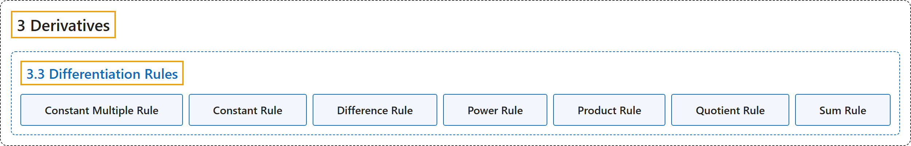

# 3.3 Differentiation Rules

## Classification

## Glossary

| Term | Definition | 中文翻译 | Source |
|---|---|---|---|
| **3 Derivatives** 导数 | (No definition) | （无定义） | [Strang & Herman, 2016a, chapter 3](https://openstax.org/books/calculus-volume-1/pages/3-introduction) |
| **3.3 Differentiation Rules** 求导法则 | (No definition) | （无定义） | [Strang & Herman, 2016a, section 3.3](https://openstax.org/books/calculus-volume-1/pages/3-3-differentiation-rules) |
| **Constant Multiple Rule** 常数倍法则 | "the derivative of a constant c multiplied by a function f is **the same as the constant multiplied by the derivative**: $\frac{d}{dx}(cf(x))=cf^{'}(x)$" | 常数 c 乘以函数 f 的导数，**等于该常数乘以导数**：$\frac{d}{dx}(cf(x))=cf^{'}(x)$ | [Strang & Herman, 2016a, chapter 3 Key Terms](https://openstax.org/books/calculus-volume-1/pages/3-key-terms#fs-id1169739289276) |
| **Constant Rule** 常数法则 | "**the derivative of a constant function is zero**: $\frac{d}{dx}(c)=0,$ where c is a constant" | **常函数的导数为零**：$\frac{d}{dx}(c)=0,$ 其中 c 为常数 | [Strang & Herman, 2016a, chapter 3 Key Terms](https://openstax.org/books/calculus-volume-1/pages/3-key-terms#fs-id1169739289342) |
| **Difference Rule** 差法则 | "the derivative of the difference of a function f and a function g is the same as **the difference of the derivative of f and the derivative of g**: $\frac{d}{dx}(f(x)-g(x))=f^{'}(x)-g^{'}(x)$" | 函数 f 与函数 g 之差的导数，等于 **f 的导数与 g 的导数之差**：$\frac{d}{dx}(f(x)-g(x))=f^{'}(x)-g^{'}(x)$ | [Strang & Herman, 2016a, chapter 3 Key Terms](https://openstax.org/books/calculus-volume-1/pages/3-key-terms#fs-id1169739289383) |
| **Power Rule** 幂法则 | "the derivative of a power function is a function in which the power on $x$ **becomes the coefficient of the term** and the power on $x$ in the derivative **decreases by 1**: If $n$ is an integer, then $\frac{d}{dx}x^{n}=nx^{n-1}$" | 幂函数的导数是这样一个函数：$x$ 的幂次**成为该项的系数**，导数中 $x$ 的幂次**减 1**：若 $n$ 为整数，则 $\frac{d}{dx}x^{n}=nx^{n-1}$ | [Strang & Herman, 2016a, chapter 3 Key Terms](https://openstax.org/books/calculus-volume-1/pages/3-key-terms#fs-id1169736592414) |
| **Product Rule** 乘积法则 | "the derivative of a product of two functions is **the derivative of the first function times the second function plus the derivative of the second function times the first function**: $\frac{d}{dx}(f(x)g(x))=f^{'}(x)g(x)+g^{'}(x)f(x)$" | 两个函数之积的导数，是**第一个函数的导数乘以第二个函数，加上第二个函数的导数乘以第一个函数**：$\frac{d}{dx}(f(x)g(x))=f^{'}(x)g(x)+g^{'}(x)f(x)$ | [Strang & Herman, 2016a, chapter 3 Key Terms](https://openstax.org/books/calculus-volume-1/pages/3-key-terms#fs-id1169736592467) |
| **Quotient Rule** 商法则 | "the derivative of the quotient of two functions is the derivative of the first function times the second function minus the derivative of the second function times the first function, **all divided by the square of the second function**: $\frac{d}{dx}(\frac{f(x)}{g(x)})=\frac{f^{'}(x)g(x)-g^{'}(x)f(x)}{(g(x))^{2}}$" | 两个函数之商的导数，是第一个函数的导数乘以第二个函数，减去第二个函数的导数乘以第一个函数，**再全部除以第二个函数的平方**：$\frac{d}{dx}(\frac{f(x)}{g(x)})=\frac{f^{'}(x)g(x)-g^{'}(x)f(x)}{(g(x))^{2}}$ | [Strang & Herman, 2016a, chapter 3 Key Terms](https://openstax.org/books/calculus-volume-1/pages/3-key-terms#fs-id1169736592566) |
| **Sum Rule** 和法则 | "the derivative of the sum of a function f and a function g is the same as **the sum of the derivative of f and the derivative of g**: $\frac{d}{dx}(f(x)+g(x))=f^{'}(x)+g^{'}(x)$" | 函数 f 与函数 g 之和的导数，等于 **f 的导数与 g 的导数之和**：$\frac{d}{dx}(f(x)+g(x))=f^{'}(x)+g^{'}(x)$ | [Strang & Herman, 2016a, chapter 3 Key Terms](https://openstax.org/books/calculus-volume-1/pages/3-key-terms#fs-id1169736661322) |

## References

Strang, G., & Herman, E. (2016a). *Calculus volume 1*. OpenStax. Retrieved October 29, 2026, from <https://openstax.org/details/books/calculus-volume-1>
