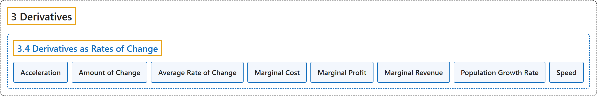

# 3.4 Derivatives as Rates of Change

## Classification

## Glossary

| Term | Definition | 中文翻译 | Source |
|---|---|---|---|
| **3 Derivatives** 导数 | (No definition) | （无定义） | [Strang & Herman, 2016a, chapter 3](https://openstax.org/books/calculus-volume-1/pages/3-introduction) |
| **3.4 Derivatives as Rates of Change** 作为变化率的导数 | (No definition) | （无定义） | [Strang & Herman, 2016a, section 3.4](https://openstax.org/books/calculus-volume-1/pages/3-4-derivatives-as-rates-of-change) |
| **Acceleration** 加速度 | "is **the rate of change of the velocity**, that is, the derivative of velocity" | 是**速度的变化率**，即速度的导数 | [Strang & Herman, 2016a, chapter 3 Key Terms](https://openstax.org/books/calculus-volume-1/pages/3-key-terms#fs-id1169739252840) |
| **Amount of Change** 变化量 | "**the amount of a function** $f(x)$ over an interval $[x,x+h]$ is $f(x+h)-f(x)$" | **函数 $f(x)$ 在区间 $[x,x+h]$ 上的变化量**是 $f(x+h)-f(x)$ | [Strang & Herman, 2016a, chapter 3 Key Terms](https://openstax.org/books/calculus-volume-1/pages/3-key-terms#fs-id1169739252849) |
| **Average Rate of Change** 平均变化率 | "is a function $f(x)$ **over an interval** $[x,x+h]$ is $\frac{f(a+h)-f(a)}{h}$" | 函数 $f(x)$ **在区间** $[x,x+h]$ 上的平均变化率是 $\frac{f(a+h)-f(a)}{h}$ | [Strang & Herman, 2016a, chapter 3 Key Terms](https://openstax.org/books/calculus-volume-1/pages/3-key-terms#fs-id1169739190003) |
| **Marginal Cost** 边际成本 | "is **the derivative of the cost function**, or **the approximate cost of producing one more item**" | 是**成本函数的导数**，或**多生产一件产品的近似成本** | [Strang & Herman, 2016a, chapter 3 Key Terms](https://openstax.org/books/calculus-volume-1/pages/3-key-terms#fs-id1169739190084) |
| **Marginal Profit** 边际利润 | "is **the derivative of the profit function**, or **the approximate profit obtained by producing and selling one more item**" | 是**利润函数的导数**，或**多生产并卖出一件产品所得的近似利润** | [Strang & Herman, 2016a, chapter 3 Key Terms](https://openstax.org/books/calculus-volume-1/pages/3-key-terms#fs-id1169739190106) |
| **Marginal Revenue** 边际收益 | "is **the derivative of the revenue function**, or **the approximate revenue obtained by selling one more item**" | 是**收益函数的导数**，或**多卖出一件产品所得的近似收益** | [Strang & Herman, 2016a, chapter 3 Key Terms](https://openstax.org/books/calculus-volume-1/pages/3-key-terms#fs-id1169739190095) |
| **Population Growth Rate** 人口增长率 | "is **the derivative of the population with respect to time**" | 是**人口对时间的导数** | [Strang & Herman, 2016a, chapter 3 Key Terms](https://openstax.org/books/calculus-volume-1/pages/3-key-terms#fs-id1169739190116) |
| **Speed** 速率 | "is **the absolute value of velocity**, that is, $\vert v(t)\vert$ is the speed of an object at time $t$ whose velocity is given by $v(t)$" | 是**速度的绝对值**，即 $\vert v(t)\vert$ 是速度为 $v(t)$ 的物体在时刻 $t$ 的速率 | [Strang & Herman, 2016a, chapter 3 Key Terms](https://openstax.org/books/calculus-volume-1/pages/3-key-terms#fs-id1169739190126) |

## References

Strang, G., & Herman, E. (2016a). *Calculus volume 1*. OpenStax. Retrieved October 29, 2026, from <https://openstax.org/details/books/calculus-volume-1>
