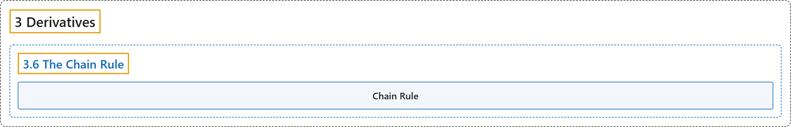

# 3.6 The Chain Rule

## Classification

## Glossary

| Term | Definition | 中文翻译 | Source |
|---|---|---|---|
| **3 Derivatives** 导数 | (No definition) | （无定义） | [Strang & Herman, 2016a, chapter 3](https://openstax.org/books/calculus-volume-1/pages/3-introduction) |
| **3.6 The Chain Rule** 链式法则 | (No definition) | （无定义） | [Strang & Herman, 2016a, section 3.6](https://openstax.org/books/calculus-volume-1/pages/3-6-the-chain-rule) |
| **Chain Rule** 链式法则 | "the chain rule defines the derivative of a composite function as **the derivative of the outer function evaluated at the inner function times the derivative of the inner function**" | 链式法则把复合函数的导数定义为**外层函数在内层函数处的导数乘以内层函数的导数** | [Strang & Herman, 2016a, chapter 3 Key Terms](https://openstax.org/books/calculus-volume-1/pages/3-key-terms#fs-id1169739296745) |

## References

Strang, G., & Herman, E. (2016a). *Calculus volume 1*. OpenStax. Retrieved October 29, 2026, from <https://openstax.org/details/books/calculus-volume-1>
