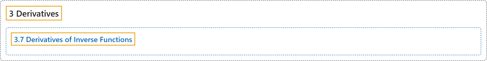

# 3.7 Derivatives of Inverse Functions

## Classification

## Glossary

| Term | Definition | 中文翻译 | Source |
|---|---|---|---|
| **3 Derivatives** 导数 | (No definition) | （无定义） | [Strang & Herman, 2016a, chapter 3](https://openstax.org/books/calculus-volume-1/pages/3-introduction) |
| **3.7 Derivatives of Inverse Functions** 反函数的导数 | (No definition) | （无定义） | [Strang & Herman, 2016a, section 3.7](https://openstax.org/books/calculus-volume-1/pages/3-7-derivatives-of-inverse-functions) |

## References

Strang, G., & Herman, E. (2016a). *Calculus volume 1*. OpenStax. Retrieved October 29, 2026, from <https://openstax.org/details/books/calculus-volume-1>
