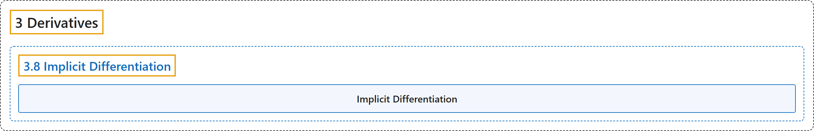

# 3.8 Implicit Differentiation

## Classification

## Glossary

| Term | Definition | 中文翻译 | Source |
|---|---|---|---|
| **3 Derivatives** 导数 | (No definition) | （无定义） | [Strang & Herman, 2016a, chapter 3](https://openstax.org/books/calculus-volume-1/pages/3-introduction) |
| **3.8 Implicit Differentiation** 隐函数求导 | (No definition) | （无定义） | [Strang & Herman, 2016a, section 3.8](https://openstax.org/books/calculus-volume-1/pages/3-8-implicit-differentiation) |
| **Implicit Differentiation** 隐函数求导 | "is a technique for computing $\frac{dy}{dx}$ for a function defined by an equation, accomplished by **differentiating both sides of the equation** (remembering to treat the variable $y$ as a function) and solving for $\frac{dy}{dx}$" | 是对由方程定义的函数计算 $\frac{dy}{dx}$ 的一种方法，做法是**对方程两边求导**（记住把变量 $y$ 当作函数），再解出 $\frac{dy}{dx}$ | [Strang & Herman, 2016a, chapter 3 Key Terms](https://openstax.org/books/calculus-volume-1/pages/3-key-terms#fs-id1169738191096) |

## References

Strang, G., & Herman, E. (2016a). *Calculus volume 1*. OpenStax. Retrieved October 29, 2026, from <https://openstax.org/details/books/calculus-volume-1>
