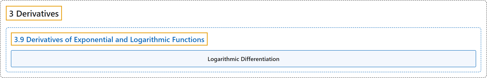

# 3.9 Derivatives of Exponential and Logarithmic Functions

## Classification

## Glossary

| Term | Definition | 中文翻译 | Source |
|---|---|---|---|
| **3 Derivatives** 导数 | (No definition) | （无定义） | [Strang & Herman, 2016a, chapter 3](https://openstax.org/books/calculus-volume-1/pages/3-introduction) |
| **3.9 Derivatives of Exponential and Logarithmic Functions** 指数函数与对数函数的导数 | (No definition) | （无定义） | [Strang & Herman, 2016a, section 3.9](https://openstax.org/books/calculus-volume-1/pages/3-9-derivatives-of-exponential-and-logarithmic-functions) |
| **Logarithmic Differentiation** 对数求导法 | "is a technique that allows us to differentiate a function by **first taking the natural logarithm of both sides of an equation**, applying properties of logarithms to simplify the equation, and differentiating implicitly" | 是一种求导方法：**先对方程两边取自然对数**，用对数的性质化简方程，再隐式求导 | [Strang & Herman, 2016a, chapter 3 Key Terms](https://openstax.org/books/calculus-volume-1/pages/3-key-terms#fs-id1169738074914) |

## References

Strang, G., & Herman, E. (2016a). *Calculus volume 1*. OpenStax. Retrieved October 29, 2026, from <https://openstax.org/details/books/calculus-volume-1>
