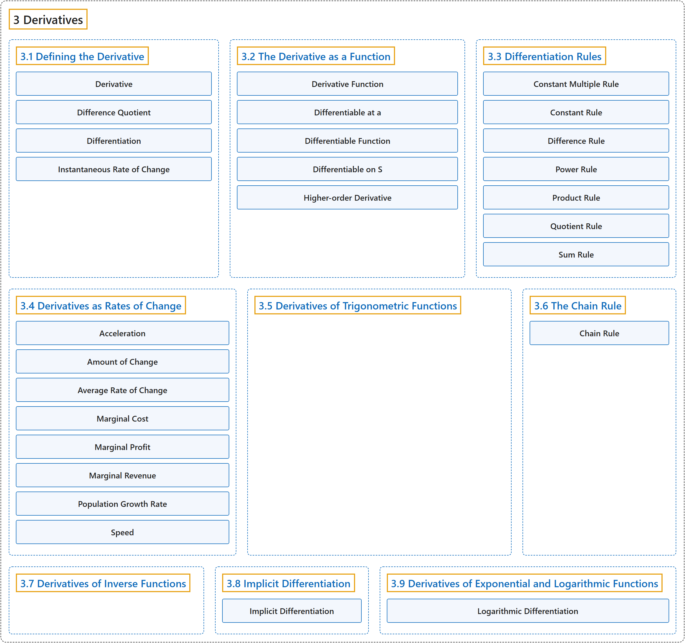

# 3 Derivatives

## Classification

## Glossary

| Term | Definition | 中文翻译 | Source |
|---|---|---|---|
| **3 Derivatives** 导数 | (No definition) | （无定义） | [Strang & Herman, 2016a, chapter 3](https://openstax.org/books/calculus-volume-1/pages/3-introduction) |
| **[3.1 Defining the Derivative](3-1-defining-the-derivative.md)** 导数的定义 | (No definition) | （无定义） | [Strang & Herman, 2016a, section 3.1](https://openstax.org/books/calculus-volume-1/pages/3-1-defining-the-derivative) |
| **[3.2 The Derivative as a Function](3-2-the-derivative-as-a-function.md)** 作为函数的导数 | (No definition) | （无定义） | [Strang & Herman, 2016a, section 3.2](https://openstax.org/books/calculus-volume-1/pages/3-2-the-derivative-as-a-function) |
| **[3.3 Differentiation Rules](3-3-differentiation-rules.md)** 求导法则 | (No definition) | （无定义） | [Strang & Herman, 2016a, section 3.3](https://openstax.org/books/calculus-volume-1/pages/3-3-differentiation-rules) |
| **[3.4 Derivatives as Rates of Change](3-4-derivatives-as-rates-of-change.md)** 作为变化率的导数 | (No definition) | （无定义） | [Strang & Herman, 2016a, section 3.4](https://openstax.org/books/calculus-volume-1/pages/3-4-derivatives-as-rates-of-change) |
| **[3.5 Derivatives of Trigonometric Functions](3-5-derivatives-of-trigonometric-functions.md)** 三角函数的导数 | (No definition) | （无定义） | [Strang & Herman, 2016a, section 3.5](https://openstax.org/books/calculus-volume-1/pages/3-5-derivatives-of-trigonometric-functions) |
| **[3.6 The Chain Rule](3-6-the-chain-rule.md)** 链式法则 | (No definition) | （无定义） | [Strang & Herman, 2016a, section 3.6](https://openstax.org/books/calculus-volume-1/pages/3-6-the-chain-rule) |
| **[3.7 Derivatives of Inverse Functions](3-7-derivatives-of-inverse-functions.md)** 反函数的导数 | (No definition) | （无定义） | [Strang & Herman, 2016a, section 3.7](https://openstax.org/books/calculus-volume-1/pages/3-7-derivatives-of-inverse-functions) |
| **[3.8 Implicit Differentiation](3-8-implicit-differentiation.md)** 隐函数求导 | (No definition) | （无定义） | [Strang & Herman, 2016a, section 3.8](https://openstax.org/books/calculus-volume-1/pages/3-8-implicit-differentiation) |
| **[3.9 Derivatives of Exponential and Logarithmic Functions](3-9-derivatives-of-exponential-and-logarithmic-functions.md)** 指数函数与对数函数的导数 | (No definition) | （无定义） | [Strang & Herman, 2016a, section 3.9](https://openstax.org/books/calculus-volume-1/pages/3-9-derivatives-of-exponential-and-logarithmic-functions) |

## References

Strang, G., & Herman, E. (2016a). *Calculus volume 1*. OpenStax. Retrieved October 29, 2026, from <https://openstax.org/details/books/calculus-volume-1>
