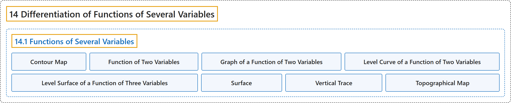

# 14.1 Functions of Several Variables

## Classification

## Glossary

| Term | Definition | 中文翻译 | Source |
|---|---|---|---|
| **14 Differentiation of Functions of Several Variables** 多元函数微分学 | (No definition) | （无定义） | [Strang & Herman, 2016c, chapter 4](https://openstax.org/books/calculus-volume-3/pages/4-introduction) |
| **14.1 Functions of Several Variables** 多元函数 | (No definition) | （无定义） | [Strang & Herman, 2016c, section 4.1](https://openstax.org/books/calculus-volume-3/pages/4-1-functions-of-several-variables) |
| **Contour Map** 等高线图 | "a plot of **the various level curves** of a given function $f(x,y)$" | 给定函数 $f(x,y)$ 的**各条等高线**的图 | [Strang & Herman, 2016c, chapter 4 Key Terms](https://openstax.org/books/calculus-volume-3/pages/4-key-terms#fs-id1167793371350) |
| **Function of Two Variables** 二元函数 | "a function $z=f(x,y)$ that maps each ordered pair $(x,y)$ in a subset $D$ of $\mathbb{R}^{2}$ **to a unique real number** $z$" | 把 $\mathbb{R}^{2}$ 的子集 $D$ 中每个有序对 $(x,y)$ 映射**到唯一实数** $z$ 的函数 $z=f(x,y)$ | [Strang & Herman, 2016c, chapter 4 Key Terms](https://openstax.org/books/calculus-volume-3/pages/4-key-terms#fs-id1167793371377) |
| **Graph of a Function of Two Variables** 二元函数的图像 | "a set of ordered triples $(x,y,z)$ that satisfies the equation $z=f(x,y)$ **plotted in three-dimensional Cartesian space**" | 满足方程 $z=f(x,y)$ 的有序三元组 $(x,y,z)$ 的集合，**画在三维笛卡儿空间中** | [Strang & Herman, 2016c, chapter 4 Key Terms](https://openstax.org/books/calculus-volume-3/pages/4-key-terms#fs-id1167793251246) |
| **Level Curve of a Function of Two Variables** 二元函数的等高线 | "the set of points satisfying the equation $f(x,y)=c$ for some real number $c$ **in the range of** $f$" | 对 $f$ **值域中**某个实数 $c$ 满足方程 $f(x,y)=c$ 的点的集合 | [Strang & Herman, 2016c, chapter 4 Key Terms](https://openstax.org/books/calculus-volume-3/pages/4-key-terms#fs-id1167793452781) |
| **Level Surface of a Function of Three Variables** 三元函数的等值面 | "the set of points satisfying the equation $f(x,y,z)=c$ for some real number $c$ **in the range of** $f$" | 对 $f$ **值域中**某个实数 $c$ 满足方程 $f(x,y,z)=c$ 的点的集合 | [Strang & Herman, 2016c, chapter 4 Key Terms](https://openstax.org/books/calculus-volume-3/pages/4-key-terms#fs-id1167793387126) |
| **Surface** 曲面 | "**the graph of a function of two variables**, $z=f(x,y)$" | **二元函数的图像**，$z=f(x,y)$ | [Strang & Herman, 2016c, chapter 4 Key Terms](https://openstax.org/books/calculus-volume-3/pages/4-key-terms#fs-id1167793418231) |
| **Vertical Trace** 竖直截痕 | "the set of ordered triples $(c,y,z)$ that solves the equation $f(c,y)=z$ **for a given constant** $x=c$ or the set of ordered triples $(x,d,z)$ that solves the equation $f(x,d)=z$ for a given constant $y=d$" | 对**给定常数** $x=c$ 满足方程 $f(c,y)=z$ 的有序三元组 $(c,y,z)$ 的集合，或对给定常数 $y=d$ 满足方程 $f(x,d)=z$ 的有序三元组 $(x,d,z)$ 的集合 | [Strang & Herman, 2016c, chapter 4 Key Terms](https://openstax.org/books/calculus-volume-3/pages/4-key-terms#fs-id1167793615241) |
| **Topographical Map** 地形图 | "If hikers walk along rugged trails, they might use **a topographical map** that shows how steeply the trails change." | 徒步者在崎岖小路上行走时，可能会用一张**地形图**，显示小路坡度变化有多陡。 | [Strang & Herman, 2016c, section 4.1](https://openstax.org/books/calculus-volume-3/pages/4-1-functions-of-several-variables#term-00003) |

## References

Strang, G., & Herman, E. (2016c). *Calculus volume 3*. OpenStax. Retrieved October 29, 2026, from <https://openstax.org/details/books/calculus-volume-3>
