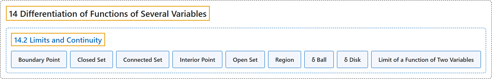

# 14.2 Limits and Continuity

## Classification

## Glossary

| Term | Definition | 中文翻译 | Source |
|---|---|---|---|
| **14 Differentiation of Functions of Several Variables** 多元函数微分学 | (No definition) | （无定义） | [Strang & Herman, 2016c, chapter 4](https://openstax.org/books/calculus-volume-3/pages/4-introduction) |
| **14.2 Limits and Continuity** 极限与连续性 | (No definition) | （无定义） | [Strang & Herman, 2016c, section 4.2](https://openstax.org/books/calculus-volume-3/pages/4-2-limits-and-continuity) |
| **Boundary Point** 边界点 | "a point $P_{0}$ of $R$ is a boundary point if every $\delta$ disk centered around $P_{0}$ **contains points both inside and outside** $R$" | $R$ 的点 $P_{0}$ 是边界点，如果以 $P_{0}$ 为中心的每个 $\delta$ 圆盘都**既含 $R$ 内部的点也含外部的点** | [Strang & Herman, 2016c, chapter 4 Key Terms](https://openstax.org/books/calculus-volume-3/pages/4-key-terms#fs-id1167794213154) |
| **Closed Set** 闭集 | "a set $S$ that **contains all its boundary points**" | **包含其全部边界点**的集合 $S$ | [Strang & Herman, 2016c, chapter 4 Key Terms](https://openstax.org/books/calculus-volume-3/pages/4-key-terms#fs-id1167793400597) |
| **Connected Set** 连通集 | "an open set $S$ that **cannot be represented as the union of two or more disjoint, nonempty open subsets**" | **不能表示为两个或更多互不相交的非空开子集之并**的开集 $S$ | [Strang & Herman, 2016c, chapter 4 Key Terms](https://openstax.org/books/calculus-volume-3/pages/4-key-terms#fs-id1167793400611) |
| **Interior Point** 内点 | "a point $P_{0}$ of $R$ is a boundary point if there is a $\delta$ disk centered around $P_{0}$ **contained completely in** $R$" | $R$ 的点 $P_{0}$ 是边界点（原文如此），如果存在以 $P_{0}$ 为中心、**完全包含于** $R$ 的 $\delta$ 圆盘 | [Strang & Herman, 2016c, chapter 4 Key Terms](https://openstax.org/books/calculus-volume-3/pages/4-key-terms#fs-id1167794143673) |
| **Open Set** 开集 | "a set $S$ that **contains none of its boundary points**" | **不含任何边界点**的集合 $S$ | [Strang & Herman, 2016c, chapter 4 Key Terms](https://openstax.org/books/calculus-volume-3/pages/4-key-terms#fs-id1167794143711) |
| **Region** 区域 | "**an open, connected, nonempty subset** of $\mathbb{R}^{2}$" | $\mathbb{R}^{2}$ 的**开的、连通的、非空的子集** | [Strang & Herman, 2016c, chapter 4 Key Terms](https://openstax.org/books/calculus-volume-3/pages/4-key-terms#fs-id1167793636362) |
| **δ Ball** δ 球 | "all points in $\mathbb{R}^{3}$ **lying at a distance of less than** $\delta$ from $(x_{0},y_{0},z_{0})$" | $\mathbb{R}^{3}$ 中与 $(x_{0},y_{0},z_{0})$ **的距离小于** $\delta$ 的所有点 | [Strang & Herman, 2016c, chapter 4 Key Terms](https://openstax.org/books/calculus-volume-3/pages/4-key-terms#fs-id1167793638101) |
| **δ Disk** δ 圆盘 | "**an open disk of radius** $\delta$ centered at point $(a,b)$" | 以点 $(a,b)$ 为中心、**半径为 $\delta$ 的开圆盘** | [Strang & Herman, 2016c, chapter 4 Key Terms](https://openstax.org/books/calculus-volume-3/pages/4-key-terms#fs-id1167793638069) |
| **Limit of a Function of Two Variables** 二元函数的极限 | "Proving that a limit exists using **the definition of a limit of a function of two variables** can be challenging." | 用**二元函数极限的定义**来证明极限存在可能很有挑战性。 | [Strang & Herman, 2016c, section 4.2](https://openstax.org/books/calculus-volume-3/pages/4-2-limits-and-continuity#term-00002) |

## References

Strang, G., & Herman, E. (2016c). *Calculus volume 3*. OpenStax. Retrieved October 29, 2026, from <https://openstax.org/details/books/calculus-volume-3>
