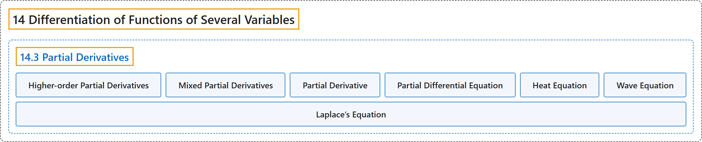

# 14.3 Partial Derivatives

## Classification

## Glossary

| Term | Definition | 中文翻译 | Source |
|---|---|---|---|
| **14 Differentiation of Functions of Several Variables** 多元函数微分学 | (No definition) | （无定义） | [Strang & Herman, 2016c, chapter 4](https://openstax.org/books/calculus-volume-3/pages/4-introduction) |
| **14.3 Partial Derivatives** 偏导数 | (No definition) | （无定义） | [Strang & Herman, 2016c, section 4.3](https://openstax.org/books/calculus-volume-3/pages/4-3-partial-derivatives) |
| **Higher-order Partial Derivatives** 高阶偏导数 | "**second-order or higher partial derivatives**, regardless of whether they are mixed partial derivatives" | **二阶或更高阶的偏导数**，不论它们是不是混合偏导数 | [Strang & Herman, 2016c, chapter 4 Key Terms](https://openstax.org/books/calculus-volume-3/pages/4-key-terms#fs-id1167793639941) |
| **Mixed Partial Derivatives** 混合偏导数 | "second-order or higher partial derivatives, in which at least two of the differentiations are **with respect to different variables**" | 二阶或更高阶的偏导数，其中至少有两次求导是**对不同变量**进行的 | [Strang & Herman, 2016c, chapter 4 Key Terms](https://openstax.org/books/calculus-volume-3/pages/4-key-terms#fs-id1167793639952) |
| **Partial Derivative** 偏导数 | "a derivative of a function of more than one independent variable in which **all the variables but one are held constant**" | 多于一个自变量的函数的导数，其中**除一个变量外其余变量都保持不变** | [Strang & Herman, 2016c, chapter 4 Key Terms](https://openstax.org/books/calculus-volume-3/pages/4-key-terms#fs-id1167793639962) |
| **Partial Differential Equation** 偏微分方程 | "an equation that involves an unknown function of more than one independent variable and **one or more of its partial derivatives**" | 含一个多于一个自变量的未知函数及其**一个或多个偏导数**的方程 | [Strang & Herman, 2016c, chapter 4 Key Terms](https://openstax.org/books/calculus-volume-3/pages/4-key-terms#fs-id1167793401428) |
| **Heat Equation** 热方程 | "(**heat equation in two dimensions**)" | （**二维热方程**） | [Strang & Herman, 2016c, section 4.3](https://openstax.org/books/calculus-volume-3/pages/4-3-partial-derivatives#term-00006) |
| **Wave Equation** 波动方程 | "(**wave equation in two dimensions**)" | （**二维波动方程**） | [Strang & Herman, 2016c, section 4.3](https://openstax.org/books/calculus-volume-3/pages/4-3-partial-derivatives#term-00007) |
| **Laplace’s Equation** 拉普拉斯方程 | "(**Laplace’s equation in two dimensions**)" | （**二维拉普拉斯方程**） | [Strang & Herman, 2016c, section 4.3](https://openstax.org/books/calculus-volume-3/pages/4-3-partial-derivatives#term-00008) |

## References

Strang, G., & Herman, E. (2016c). *Calculus volume 3*. OpenStax. Retrieved October 29, 2026, from <https://openstax.org/details/books/calculus-volume-3>
