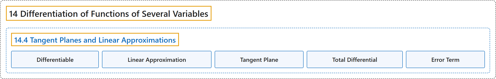

# 14.4 Tangent Planes and Linear Approximations

## Classification

## Glossary

| Term | Definition | 中文翻译 | Source |
|---|---|---|---|
| **14 Differentiation of Functions of Several Variables** 多元函数微分学 | (No definition) | （无定义） | [Strang & Herman, 2016c, chapter 4](https://openstax.org/books/calculus-volume-3/pages/4-introduction) |
| **14.4 Tangent Planes and Linear Approximations** 切平面与线性近似 | (No definition) | （无定义） | [Strang & Herman, 2016c, section 4.4](https://openstax.org/books/calculus-volume-3/pages/4-4-tangent-planes-and-linear-approximations) |
| **Differentiable** 可微 | "a function $f(x,y,z)$ is differentiable at $(x_{0},y_{0})$ if $f(x,y)$ **can be expressed in the form** $f(x,y)=f(x_{0},y_{0})+f_{x}(x_{0},y_{0})(x-x_{0})+f_{y}(x_{0},y_{0})(y-y_{0})+E(x,y),$ where the error term $E(x,y)$ satisfies $\lim_{(x,y)\to (x_{0},y_{0})}\frac{E(x,y)}{\sqrt{(x-x_{0})^{2}+(y-y_{0})^{2}}}=0$" | 函数 $f(x,y,z)$ 在 $(x_{0},y_{0})$ 处可微，如果 $f(x,y)$ **可以表示成形式** $f(x,y)=f(x_{0},y_{0})+f_{x}(x_{0},y_{0})(x-x_{0})+f_{y}(x_{0},y_{0})(y-y_{0})+E(x,y),$ 其中误差项 $E(x,y)$ 满足 $\lim_{(x,y)\to (x_{0},y_{0})}\frac{E(x,y)}{\sqrt{(x-x_{0})^{2}+(y-y_{0})^{2}}}=0$ | [Strang & Herman, 2016c, chapter 4 Key Terms](https://openstax.org/books/calculus-volume-3/pages/4-key-terms#fs-id1167793383358) |
| **Linear Approximation** 线性近似 | "given a function $f(x,y)$ and a tangent plane to the function at a point $(x_{0},y_{0}),$ we can approximate $f(x,y)$ for points near $(x_{0},y_{0})$ **using the tangent plane formula**" | 给定函数 $f(x,y)$ 及其在点 $(x_{0},y_{0}),$ 处的切平面，可以**用切平面公式**对 $(x_{0},y_{0})$ 附近的点近似 $f(x,y)$ | [Strang & Herman, 2016c, chapter 4 Key Terms](https://openstax.org/books/calculus-volume-3/pages/4-key-terms#fs-id1167794139991) |
| **Tangent Plane** 切平面 | "given a function $f(x,y)$ that is differentiable at a point $(x_{0},y_{0}),$ **the equation of the tangent plane** to the surface $z=f(x,y)$ is given by $z=f(x_{0},y_{0})+f_{x}(x_{0},y_{0})(x-x_{0})+f_{y}(x_{0},y_{0})(y-y_{0})$" | 给定在点 $(x_{0},y_{0}),$ 处可微的函数 $f(x,y)$，曲面 $z=f(x,y)$ 的**切平面方程**由 $z=f(x_{0},y_{0})+f_{x}(x_{0},y_{0})(x-x_{0})+f_{y}(x_{0},y_{0})(y-y_{0})$ 给出 | [Strang & Herman, 2016c, chapter 4 Key Terms](https://openstax.org/books/calculus-volume-3/pages/4-key-terms#fs-id1167793423603) |
| **Total Differential** 全微分 | "**the total differential** of the function $f(x,y)$ at $(x_{0},y_{0})$ is given by the formula $dz=f_{x}(x_{0},y_{0})dx+f_{y}(x_{0},y_{0})dy$" | 函数 $f(x,y)$ 在 $(x_{0},y_{0})$ 处的**全微分**由公式 $dz=f_{x}(x_{0},y_{0})dx+f_{y}(x_{0},y_{0})dy$ 给出 | [Strang & Herman, 2016c, chapter 4 Key Terms](https://openstax.org/books/calculus-volume-3/pages/4-key-terms#fs-id1167793627810) |
| **Error Term** 误差项 | "The last term in Equation 4.26 is referred to as **the error term** and it represents how closely the tangent plane comes to the surface in a small neighborhood $(\delta$ disk) of point $P.$" | 方程 4.26 的最后一项称为**误差项**，它表示切平面在点 $P.$ 的小邻域 $(\delta$ 圆盘）内与曲面有多接近 | [Strang & Herman, 2016c, section 4.4](https://openstax.org/books/calculus-volume-3/pages/4-4-tangent-planes-and-linear-approximations#term-00004) |

## References

Strang, G., & Herman, E. (2016c). *Calculus volume 3*. OpenStax. Retrieved October 29, 2026, from <https://openstax.org/details/books/calculus-volume-3>
