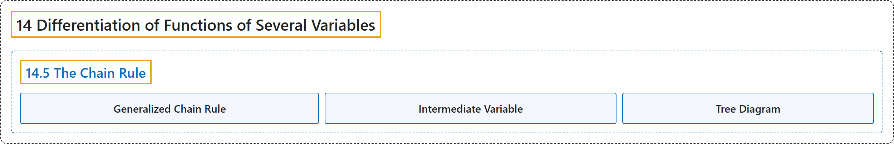

# 14.5 The Chain Rule

## Classification

## Glossary

| Term | Definition | 中文翻译 | Source |
|---|---|---|---|
| **14 Differentiation of Functions of Several Variables** 多元函数微分学 | (No definition) | （无定义） | [Strang & Herman, 2016c, chapter 4](https://openstax.org/books/calculus-volume-3/pages/4-introduction) |
| **14.5 The Chain Rule** 链式法则 | (No definition) | （无定义） | [Strang & Herman, 2016c, section 4.5](https://openstax.org/books/calculus-volume-3/pages/4-5-the-chain-rule) |
| **Generalized Chain Rule** 广义链式法则 | "the chain rule extended to **functions of more than one independent variable**, in which each independent variable may depend on one or more other variables" | 推广到**多于一个自变量的函数**的链式法则，其中每个自变量又可以依赖于一个或多个其他变量 | [Strang & Herman, 2016c, chapter 4 Key Terms](https://openstax.org/books/calculus-volume-3/pages/4-key-terms#fs-id1167794046719) |
| **Intermediate Variable** 中间变量 | "given a composition of functions (e.g., $f(x(t),y(t))),$ the intermediate variables are the variables that are **independent in the outer function but dependent on other variables** as well; in the function $f(x(t),y(t)),$ the variables $x\,\text{and}\,y$ are examples of intermediate variables" | 给定函数的复合（如 $f(x(t),y(t))),$），中间变量是**在外层函数中独立、但又依赖于其他变量**的变量；在函数 $f(x(t),y(t)),$ 中，变量 $x\,\text{and}\,y$ 就是中间变量的例子 | [Strang & Herman, 2016c, chapter 4 Key Terms](https://openstax.org/books/calculus-volume-3/pages/4-key-terms#fs-id1167794046730) |
| **Tree Diagram** 树形图 | "illustrates and derives **formulas for the generalized chain rule**, in which each independent variable is accounted for" | 说明并推导**广义链式法则的公式**，其中考虑到每个自变量 | [Strang & Herman, 2016c, chapter 4 Key Terms](https://openstax.org/books/calculus-volume-3/pages/4-key-terms#fs-id1167793489581) |

## References

Strang, G., & Herman, E. (2016c). *Calculus volume 3*. OpenStax. Retrieved October 29, 2026, from <https://openstax.org/details/books/calculus-volume-3>
