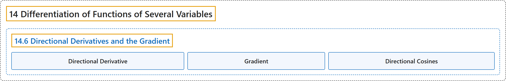

# 14.6 Directional Derivatives and the Gradient

## Classification

## Glossary

| Term | Definition | 中文翻译 | Source |
|---|---|---|---|
| **14 Differentiation of Functions of Several Variables** 多元函数微分学 | (No definition) | （无定义） | [Strang & Herman, 2016c, chapter 4](https://openstax.org/books/calculus-volume-3/pages/4-introduction) |
| **14.6 Directional Derivatives and the Gradient** 方向导数与梯度 | (No definition) | （无定义） | [Strang & Herman, 2016c, section 4.6](https://openstax.org/books/calculus-volume-3/pages/4-6-directional-derivatives-and-the-gradient) |
| **Directional Derivative** 方向导数 | "the derivative of a function **in the direction of a given unit vector**" | 函数**沿给定单位向量方向**的导数 | [Strang & Herman, 2016c, chapter 4 Key Terms](https://openstax.org/books/calculus-volume-3/pages/4-key-terms#fs-id1167793912012) |
| **Gradient** 梯度 | "the gradient of the function $f(x,y)$ is defined to be $\nabla f(x,y)=(\partial f/\partial x)i+(\partial f/\partial y)j,$ which can be generalized to **a function of any number of independent variables**" | 函数 $f(x,y)$ 的梯度定义为 $\nabla f(x,y)=(\partial f/\partial x)i+(\partial f/\partial y)j,$ 它可以推广到**任意多个自变量的函数** | [Strang & Herman, 2016c, chapter 4 Key Terms](https://openstax.org/books/calculus-volume-3/pages/4-key-terms#fs-id1167793912021) |
| **Directional Cosines** 方向余弦 | "This vector is a unit vector, and the components of the unit vector are called **directional cosines**." | 这个向量是单位向量，单位向量的分量称为**方向余弦**。 | [Strang & Herman, 2016c, section 4.6](https://openstax.org/books/calculus-volume-3/pages/4-6-directional-derivatives-and-the-gradient#term-00003) |

## References

Strang, G., & Herman, E. (2016c). *Calculus volume 3*. OpenStax. Retrieved October 29, 2026, from <https://openstax.org/details/books/calculus-volume-3>
