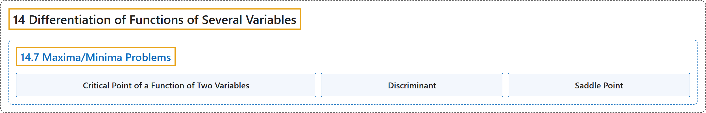

# 14.7 Maxima/Minima Problems

## Classification

## Glossary

| Term | Definition | 中文翻译 | Source |
|---|---|---|---|
| **14 Differentiation of Functions of Several Variables** 多元函数微分学 | (No definition) | （无定义） | [Strang & Herman, 2016c, chapter 4](https://openstax.org/books/calculus-volume-3/pages/4-introduction) |
| **14.7 Maxima/Minima Problems** 最大值与最小值问题 | (No definition) | （无定义） | [Strang & Herman, 2016c, section 4.7](https://openstax.org/books/calculus-volume-3/pages/4-7-maxima-minima-problems) |
| **Critical Point of a Function of Two Variables** 二元函数的临界点 | "the point $(x_{0},y_{0})$ is called a critical point of $f(x,y)$ if **one of the two following conditions holds**: $f_{x}(x_{0},y_{0})=f_{y}(x_{0},y_{0})=0$ At least one of $f_{x}(x_{0},y_{0})$ and $f_{y}(x_{0},y_{0})$ do not exist" | 点 $(x_{0},y_{0})$ 称为 $f(x,y)$ 的临界点，如果**以下两个条件之一成立**：$f_{x}(x_{0},y_{0})=f_{y}(x_{0},y_{0})=0$；$f_{x}(x_{0},y_{0})$ 和 $f_{y}(x_{0},y_{0})$ 中至少有一个不存在 | [Strang & Herman, 2016c, chapter 4 Key Terms](https://openstax.org/books/calculus-volume-3/pages/4-key-terms#fs-id1167793449052) |
| **Discriminant** 判别式 | "**the discriminant** of the function $f(x,y)$ is given by the formula $D=f_{xx}(x_{0},y_{0})f_{yy}(x_{0},y_{0})-(f_{xy}(x_{0},y_{0}))^{2}$" | 函数 $f(x,y)$ 的**判别式**由公式 $D=f_{xx}(x_{0},y_{0})f_{yy}(x_{0},y_{0})-(f_{xy}(x_{0},y_{0}))^{2}$ 给出 | [Strang & Herman, 2016c, chapter 4 Key Terms](https://openstax.org/books/calculus-volume-3/pages/4-key-terms#fs-id1167793911866) |
| **Saddle Point** 鞍点 | "given the function $z=f(x,y),$ the point $(x_{0},y_{0},f(x_{0},y_{0}))$ is a saddle point if both $f_{x}(x_{0},y_{0})=0$ and $f_{y}(x_{0},y_{0})=0,$ but $f$ **does not have a local extremum** at $(x_{0},y_{0})$" | 给定函数 $z=f(x,y),$ 点 $(x_{0},y_{0},f(x_{0},y_{0}))$ 是鞍点，如果 $f_{x}(x_{0},y_{0})=0$ 和 $f_{y}(x_{0},y_{0})=0,$ 都成立，但 $f$ 在 $(x_{0},y_{0})$ 处**没有局部极值** | [Strang & Herman, 2016c, chapter 4 Key Terms](https://openstax.org/books/calculus-volume-3/pages/4-key-terms#fs-id1167793397614) |

## References

Strang, G., & Herman, E. (2016c). *Calculus volume 3*. OpenStax. Retrieved October 29, 2026, from <https://openstax.org/details/books/calculus-volume-3>
