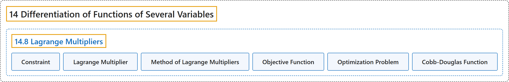

# 14.8 Lagrange Multipliers

## Classification

## Glossary

| Term | Definition | 中文翻译 | Source |
|---|---|---|---|
| **14 Differentiation of Functions of Several Variables** 多元函数微分学 | (No definition) | （无定义） | [Strang & Herman, 2016c, chapter 4](https://openstax.org/books/calculus-volume-3/pages/4-introduction) |
| **14.8 Lagrange Multipliers** 拉格朗日乘数 | (No definition) | （无定义） | [Strang & Herman, 2016c, section 4.8](https://openstax.org/books/calculus-volume-3/pages/4-8-lagrange-multipliers) |
| **Constraint** 约束 | "an inequality or equation involving one or more variables that is used in an optimization problem; the constraint **enforces a limit on the possible solutions** for the problem" | 最优化问题中使用的含一个或多个变量的不等式或方程；约束**对问题的可能解施加限制** | [Strang & Herman, 2016c, chapter 4 Key Terms](https://openstax.org/books/calculus-volume-3/pages/4-key-terms#fs-id1167793925204) |
| **Lagrange Multiplier** 拉格朗日乘数 | "**the constant (or constants) used in the method of Lagrange multipliers**; in the case of one constant, it is represented by the variable $\lambda$" | **拉格朗日乘数法中使用的常数（一个或多个）**；在一个常数的情形下，它用变量 $\lambda$ 表示 | [Strang & Herman, 2016c, chapter 4 Key Terms](https://openstax.org/books/calculus-volume-3/pages/4-key-terms#fs-id1167793925215) |
| **Method of Lagrange Multipliers** 拉格朗日乘数法 | "a method of solving an optimization problem **subject to one or more constraints**" | 求解**受一个或多个约束**的最优化问题的方法 | [Strang & Herman, 2016c, chapter 4 Key Terms](https://openstax.org/books/calculus-volume-3/pages/4-key-terms#fs-id1167794223690) |
| **Objective Function** 目标函数 | "the function that is **to be maximized or minimized** in an optimization problem" | 最优化问题中**要最大化或最小化**的函数 | [Strang & Herman, 2016c, chapter 4 Key Terms](https://openstax.org/books/calculus-volume-3/pages/4-key-terms#fs-id1167794223700) |
| **Optimization Problem** 最优化问题 | "calculation of **a maximum or minimum value of a function of several variables**, often using Lagrange multipliers" | 计算**多元函数的最大值或最小值**，常用拉格朗日乘数 | [Strang & Herman, 2016c, chapter 4 Key Terms](https://openstax.org/books/calculus-volume-3/pages/4-key-terms#fs-id1167794223709) |
| **Cobb-Douglas Function** 柯布-道格拉斯函数 | "An example of an optimization function with three variables could be **the Cobb-Douglas function** in the previous example: $f(x,y,z)=x^{0.2}y^{0.4}z^{0.4},$ where $x$ represents the cost of labor, $y$ represents capital input, and $z$ represents the cost of advertising." | 三变量最优化函数的一个例子可以是上一个例子中的**柯布-道格拉斯函数**：$f(x,y,z)=x^{0.2}y^{0.4}z^{0.4},$ 其中 $x$ 表示劳动成本，$y$ 表示资本投入，$z$ 表示广告成本。 | [Strang & Herman, 2016c, section 4.8](https://openstax.org/books/calculus-volume-3/pages/4-8-lagrange-multipliers#term-00006) |

## References

Strang, G., & Herman, E. (2016c). *Calculus volume 3*. OpenStax. Retrieved October 29, 2026, from <https://openstax.org/details/books/calculus-volume-3>
