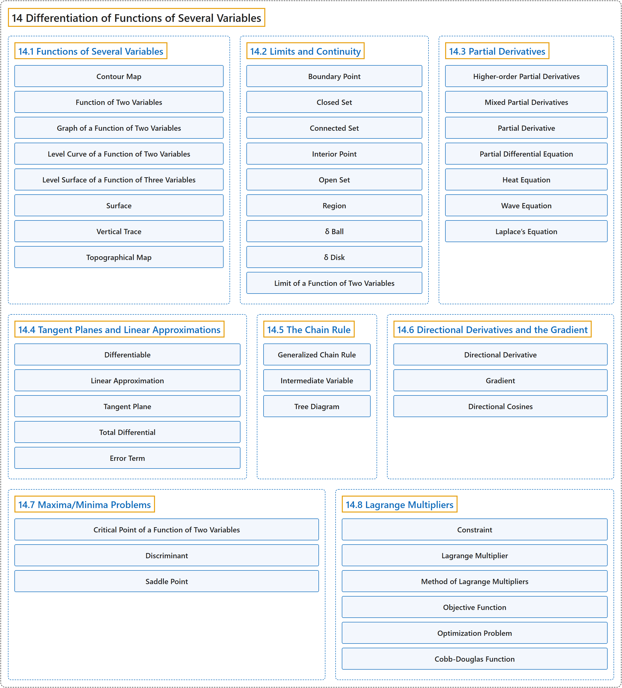

# 14 Differentiation of Functions of Several Variables

## Classification

## Glossary

| Term | Definition | 中文翻译 | Source |
|---|---|---|---|
| **14 Differentiation of Functions of Several Variables** 多元函数微分学 | (No definition) | （无定义） | [Strang & Herman, 2016c, chapter 4](https://openstax.org/books/calculus-volume-3/pages/4-introduction) |
| **[14.1 Functions of Several Variables](14-1-functions-of-several-variables.md)** 多元函数 | (No definition) | （无定义） | [Strang & Herman, 2016c, section 4.1](https://openstax.org/books/calculus-volume-3/pages/4-1-functions-of-several-variables) |
| **[14.2 Limits and Continuity](14-2-limits-and-continuity.md)** 极限与连续性 | (No definition) | （无定义） | [Strang & Herman, 2016c, section 4.2](https://openstax.org/books/calculus-volume-3/pages/4-2-limits-and-continuity) |
| **[14.3 Partial Derivatives](14-3-partial-derivatives.md)** 偏导数 | (No definition) | （无定义） | [Strang & Herman, 2016c, section 4.3](https://openstax.org/books/calculus-volume-3/pages/4-3-partial-derivatives) |
| **[14.4 Tangent Planes and Linear Approximations](14-4-tangent-planes-and-linear-approximations.md)** 切平面与线性近似 | (No definition) | （无定义） | [Strang & Herman, 2016c, section 4.4](https://openstax.org/books/calculus-volume-3/pages/4-4-tangent-planes-and-linear-approximations) |
| **[14.5 The Chain Rule](14-5-the-chain-rule.md)** 链式法则 | (No definition) | （无定义） | [Strang & Herman, 2016c, section 4.5](https://openstax.org/books/calculus-volume-3/pages/4-5-the-chain-rule) |
| **[14.6 Directional Derivatives and the Gradient](14-6-directional-derivatives-and-the-gradient.md)** 方向导数与梯度 | (No definition) | （无定义） | [Strang & Herman, 2016c, section 4.6](https://openstax.org/books/calculus-volume-3/pages/4-6-directional-derivatives-and-the-gradient) |
| **[14.7 Maxima/Minima Problems](14-7-maxima-minima-problems.md)** 最大值与最小值问题 | (No definition) | （无定义） | [Strang & Herman, 2016c, section 4.7](https://openstax.org/books/calculus-volume-3/pages/4-7-maxima-minima-problems) |
| **[14.8 Lagrange Multipliers](14-8-lagrange-multipliers.md)** 拉格朗日乘数 | (No definition) | （无定义） | [Strang & Herman, 2016c, section 4.8](https://openstax.org/books/calculus-volume-3/pages/4-8-lagrange-multipliers) |

## References

Strang, G., & Herman, E. (2016c). *Calculus volume 3*. OpenStax. Retrieved October 29, 2026, from <https://openstax.org/details/books/calculus-volume-3>
