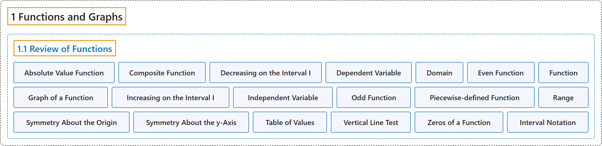

# 1.1 Review of Functions

## Classification

## Glossary

| Term | Definition | 中文翻译 | Source |
|---|---|---|---|
| **1 Functions and Graphs** 函数与图像 | (No definition) | （无定义） | [Strang & Herman, 2016a, chapter 1](https://openstax.org/books/calculus-volume-1/pages/1-introduction) |
| **1.1 Review of Functions** 函数复习 | (No definition) | （无定义） | [Strang & Herman, 2016a, section 1.1](https://openstax.org/books/calculus-volume-1/pages/1-1-review-of-functions) |
| **Absolute Value Function** 绝对值函数 | "$f(x)=\begin{cases}-x,x<0 \\ x,x\ge 0\end{cases}$" | $f(x)=\begin{cases}-x,x<0 \\ x,x\ge 0\end{cases}$ | [Strang & Herman, 2016a, chapter 1 Key Terms](https://openstax.org/books/calculus-volume-1/pages/1-key-terms#fs-id1170572443492) |
| **Composite Function** 复合函数 | "given two functions $f$ and $g,$ **a new function**, denoted $g\circ f,$ such that $(g\circ f)(x)=g(f(x))$" | 给定两个函数 $f$ 和 $g,$ 一个**新函数**，记作 $g\circ f,$ 使得 $(g\circ f)(x)=g(f(x))$ | [Strang & Herman, 2016a, chapter 1 Key Terms](https://openstax.org/books/calculus-volume-1/pages/1-key-terms#fs-id1170572443550) |
| **Decreasing on the Interval I** 在区间 I 上递减 | "a function **decreasing on the interval** $I$ if, for all $x_{1},x_{2}\in I,f(x_{1})\ge f(x_{2})$ if $x_{1}<x_{2}$" | 函数在区间 $I$ 上**递减**，如果对所有 $x_{1},x_{2}\in I,f(x_{1})\ge f(x_{2})$ 只要 $x_{1}<x_{2}$ | [Strang & Herman, 2016a, chapter 1 Key Terms](https://openstax.org/books/calculus-volume-1/pages/1-key-terms#fs-id1170572548156) |
| **Dependent Variable** 因变量 | "**the output variable** for a function" | 函数的**输出变量** | [Strang & Herman, 2016a, chapter 1 Key Terms](https://openstax.org/books/calculus-volume-1/pages/1-key-terms#fs-id1170573520938) |
| **Domain** 定义域 | "**the set of inputs** for a function" | 函数的**输入的集合** | [Strang & Herman, 2016a, chapter 1 Key Terms](https://openstax.org/books/calculus-volume-1/pages/1-key-terms#fs-id1170572548257) |
| **Even Function** 偶函数 | "**a function is even** if $f(-x)=f(x)$ for all $x$ in the domain of $f$" | **函数是偶函数**，如果对 $f$ 定义域中的所有 $x$ 都有 $f(-x)=f(x)$ | [Strang & Herman, 2016a, chapter 1 Key Terms](https://openstax.org/books/calculus-volume-1/pages/1-key-terms#fs-id1170572548267) |
| **Function** 函数 | "**a set of inputs**, **a set of outputs**, and **a rule for mapping each input to exactly one output**" | **一个输入集合**、**一个输出集合**，以及**把每个输入映射到恰好一个输出的规则** | [Strang & Herman, 2016a, chapter 1 Key Terms](https://openstax.org/books/calculus-volume-1/pages/1-key-terms#fs-id1170572548320) |
| **Graph of a Function** 函数的图像 | "**the set of points** $(x,y)$ such that $x$ is in the domain of $f$ and $y=f(x)$" | **点的集合** $(x,y),$ 其中 $x$ 在 $f$ 的定义域内且 $y=f(x)$ | [Strang & Herman, 2016a, chapter 1 Key Terms](https://openstax.org/books/calculus-volume-1/pages/1-key-terms#fs-id1170572549925) |
| **Increasing on the Interval I** 在区间 I 上递增 | "a function **increasing on the interval** $I$ if for all $x_{1},x_{2}\in I,f(x_{1})\le f(x_{2})$ if $x_{1}<x_{2}$" | 函数在区间 $I$ 上**递增**，如果对所有 $x_{1},x_{2}\in I,f(x_{1})\le f(x_{2})$ 只要 $x_{1}<x_{2}$ | [Strang & Herman, 2016a, chapter 1 Key Terms](https://openstax.org/books/calculus-volume-1/pages/1-key-terms#fs-id1170572549980) |
| **Independent Variable** 自变量 | "**the input variable** for a function" | 函数的**输入变量** | [Strang & Herman, 2016a, chapter 1 Key Terms](https://openstax.org/books/calculus-volume-1/pages/1-key-terms#fs-id1170572550070) |
| **Odd Function** 奇函数 | "**a function is odd** if $f(-x)=-f(x)$ for all $x$ in the domain of $f$" | **函数是奇函数**，如果对 $f$ 定义域中的所有 $x$ 都有 $f(-x)=-f(x)$ | [Strang & Herman, 2016a, chapter 1 Key Terms](https://openstax.org/books/calculus-volume-1/pages/1-key-terms#fs-id1170572550080) |
| **Piecewise-defined Function** 分段定义函数 | "a function that is **defined differently on different parts of its domain**" | 在其定义域的不同部分**有不同定义**的函数 | [Strang & Herman, 2016a, chapter 1 Key Terms](https://openstax.org/books/calculus-volume-1/pages/1-key-terms#fs-id1170573596582) |
| **Range** 值域 | "**the set of outputs** for a function" | 函数的**输出的集合** | [Strang & Herman, 2016a, chapter 1 Key Terms](https://openstax.org/books/calculus-volume-1/pages/1-key-terms#fs-id1170572550135) |
| **Symmetry About the Origin** 关于原点对称 | "the graph of a function $f$ is **symmetric about the origin** if $(-x,-y)$ is on the graph of $f$ whenever $(x,y)$ is on the graph" | 函数 $f$ 的图像**关于原点对称**，如果只要 $(x,y)$ 在图像上，$(-x,-y)$ 就在 $f$ 的图像上 | [Strang & Herman, 2016a, chapter 1 Key Terms](https://openstax.org/books/calculus-volume-1/pages/1-key-terms#fs-id1170572235105) |
| **Symmetry About the y-Axis** 关于 y 轴对称 | "the graph of a function $f$ **is symmetric about the** $y$-axis if $(-x,y)$ is on the graph of $f$ whenever $(x,y)$ is on the graph" | 函数 $f$ 的图像**关于 $y$ 轴对称**，如果只要 $(x,y)$ 在图像上，$(-x,y)$ 就在 $f$ 的图像上 | [Strang & Herman, 2016a, chapter 1 Key Terms](https://openstax.org/books/calculus-volume-1/pages/1-key-terms#fs-id1170572235164) |
| **Table of Values** 值表 | "a table containing **a list of inputs and their corresponding outputs**" | 包含**一列输入及其对应输出**的表 | [Strang & Herman, 2016a, chapter 1 Key Terms](https://openstax.org/books/calculus-volume-1/pages/1-key-terms#fs-id1170572235230) |
| **Vertical Line Test** 竖线检验 | "given the graph of a function, **every vertical line intersects the graph, at most, once**" | 给定一个函数的图像，**每条竖直线与图像至多相交一次** | [Strang & Herman, 2016a, chapter 1 Key Terms](https://openstax.org/books/calculus-volume-1/pages/1-key-terms#fs-id1170572235240) |
| **Zeros of a Function** 函数的零点 | "when a real number $x$ **is a zero of a function** $f,f(x)=0$" | 当实数 $x$ **是函数的零点**时，$f,f(x)=0$ | [Strang & Herman, 2016a, chapter 1 Key Terms](https://openstax.org/books/calculus-volume-1/pages/1-key-terms#fs-id1170572235250) |
| **Interval Notation** 区间记号 | "A set such as this, which contains all numbers greater than $a$ and less than $b,$ can also be denoted using the **interval notation** $(a,b).$" | 这样一个集合包含所有大于 $a$ 且小于 $b$ 的数，也可以用**区间记号** $(a,b)$ 表示。因此， | [Strang & Herman, 2016a, section 1.1](https://openstax.org/books/calculus-volume-1/pages/1-1-review-of-functions#term-00009) |

## References

Strang, G., & Herman, E. (2016a). *Calculus volume 1*. OpenStax. Retrieved October 29, 2026, from <https://openstax.org/details/books/calculus-volume-1>
