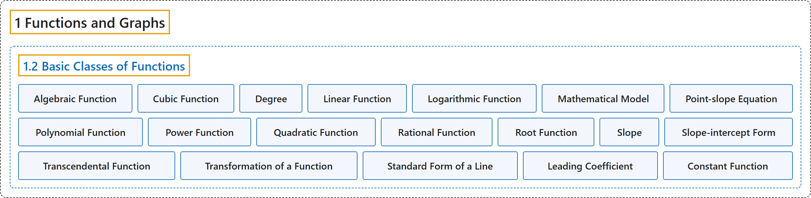

# 1.2 Basic Classes of Functions

## Classification

## Glossary

| Term | Definition | 中文翻译 | Source |
|---|---|---|---|
| **1 Functions and Graphs** 函数与图像 | (No definition) | （无定义） | [Strang & Herman, 2016a, chapter 1](https://openstax.org/books/calculus-volume-1/pages/1-introduction) |
| **1.2 Basic Classes of Functions** 函数的基本类型 | (No definition) | （无定义） | [Strang & Herman, 2016a, section 1.2](https://openstax.org/books/calculus-volume-1/pages/1-2-basic-classes-of-functions) |
| **Algebraic Function** 代数函数 | "a function involving any combination of only the basic operations of **addition, subtraction, multiplication, division, powers, and roots** applied to an input variable $x$" | 只对输入变量 $x$ 施加**加、减、乘、除、乘方和开方**这些基本运算的任意组合所得的函数 | [Strang & Herman, 2016a, chapter 1 Key Terms](https://openstax.org/books/calculus-volume-1/pages/1-key-terms#fs-id1170573596356) |
| **Cubic Function** 三次函数 | "**a polynomial of degree 3**; that is, a function of the form $f(x)=ax^{3}+bx^{2}+cx+d,$ where $a\ne 0$" | **3 次多项式**；即形如 $f(x)=ax^{3}+bx^{2}+cx+d,$ 的函数，其中 $a\ne 0$ | [Strang & Herman, 2016a, chapter 1 Key Terms](https://openstax.org/books/calculus-volume-1/pages/1-key-terms#fs-id1170573596371) |
| **Degree** 次数 | "for a polynomial function, the value of **the largest exponent** of any term" | 对多项式函数而言，任一项的**最大指数**的值 | [Strang & Herman, 2016a, chapter 1 Key Terms](https://openstax.org/books/calculus-volume-1/pages/1-key-terms#fs-id1170573596434) |
| **Linear Function** 线性函数 | "a function that **can be written in the form** $f(x)=mx+b$" | **可以写成 $f(x)=mx+b$ 形式**的函数 | [Strang & Herman, 2016a, chapter 1 Key Terms](https://openstax.org/books/calculus-volume-1/pages/1-key-terms#fs-id1170573596443) |
| **Logarithmic Function** 对数函数 | "a function of the form $f(x)={\log }_{b}(x)$ **for some base** $b>0,b\ne 1$ such that $y={\log }_{b}(x)$ if and only if $b^{y}=x$" | 形如 $f(x)={\log }_{b}(x)$ 的函数，**对某个底** $b>0,b\ne 1$ 满足：$y={\log }_{b}(x)$ 当且仅当 $b^{y}=x$ | [Strang & Herman, 2016a, chapter 1 Key Terms](https://openstax.org/books/calculus-volume-1/pages/1-key-terms#fs-id1170573596475) |
| **Mathematical Model** 数学模型 | "A method of **simulating real-life situations** with mathematical equations" | 用数学方程**模拟现实情境**的一种方法 | [Strang & Herman, 2016a, chapter 1 Key Terms](https://openstax.org/books/calculus-volume-1/pages/1-key-terms#fs-id1170573596572) |
| **Point-slope Equation** 点斜式方程 | "equation of a linear function indicating **its slope and a point on the graph** of the function" | 表明**斜率和图像上一点**的线性函数方程 | [Strang & Herman, 2016a, chapter 1 Key Terms](https://openstax.org/books/calculus-volume-1/pages/1-key-terms#fs-id1170573596592) |
| **Polynomial Function** 多项式函数 | "**a function of the form** $f(x)=a_{n}x^{n}+a_{n-1}x^{n-1}+\ldots +a_{1}x+a_{0}$" | **形如 $f(x)=a_{n}x^{n}+a_{n-1}x^{n-1}+\ldots +a_{1}x+a_{0}$ 的函数** | [Strang & Herman, 2016a, chapter 1 Key Terms](https://openstax.org/books/calculus-volume-1/pages/1-key-terms#fs-id1170573596602) |
| **Power Function** 幂函数 | "a function of the form $f(x)=x^{n}$ **for any positive integer** $n\ge 1$" | 形如 $f(x)=x^{n}$ 的函数，其中 $n\ge 1$ 为**任意正整数** | [Strang & Herman, 2016a, chapter 1 Key Terms](https://openstax.org/books/calculus-volume-1/pages/1-key-terms#fs-id1170573596682) |
| **Quadratic Function** 二次函数 | "**a polynomial of degree 2**; that is, a function of the form $f(x)=ax^{2}+bx+c$ where $a\ne 0$" | **2 次多项式**；即形如 $f(x)=ax^{2}+bx+c$ 的函数，其中 $a\ne 0$ | [Strang & Herman, 2016a, chapter 1 Key Terms](https://openstax.org/books/calculus-volume-1/pages/1-key-terms#fs-id1170573596721) |
| **Rational Function** 有理函数 | "a function of the form $f(x)=p(x)/q(x),$ where $p(x)$ and $q(x)$ **are polynomials**" | 形如 $f(x)=p(x)/q(x),$ 的函数，其中 $p(x)$ 和 $q(x)$ **是多项式** | [Strang & Herman, 2016a, chapter 1 Key Terms](https://openstax.org/books/calculus-volume-1/pages/1-key-terms#fs-id1170573596772) |
| **Root Function** 根式函数 | "a function of the form $f(x)=x^{1/n}$ **for any integer** $n\ge 2$" | 形如 $f(x)=x^{1/n}$ 的函数，其中 $n\ge 2$ 为**任意整数** | [Strang & Herman, 2016a, chapter 1 Key Terms](https://openstax.org/books/calculus-volume-1/pages/1-key-terms#fs-id1170573596850) |
| **Slope** 斜率 | "**the change in y for each unit change in x**" | **x 每变化一个单位时 y 的变化量** | [Strang & Herman, 2016a, chapter 1 Key Terms](https://openstax.org/books/calculus-volume-1/pages/1-key-terms#fs-id1170573596895) |
| **Slope-intercept Form** 斜截式 | "equation of a linear function indicating **its slope and y-intercept**" | 表明**斜率和 y 截距**的线性函数方程 | [Strang & Herman, 2016a, chapter 1 Key Terms](https://openstax.org/books/calculus-volume-1/pages/1-key-terms#fs-id1170573596915) |
| **Transcendental Function** 超越函数 | "a function that **cannot be expressed by a combination of basic arithmetic operations**" | **不能用基本算术运算的组合表示**的函数 | [Strang & Herman, 2016a, chapter 1 Key Terms](https://openstax.org/books/calculus-volume-1/pages/1-key-terms#fs-id1170573596940) |
| **Transformation of a Function** 函数的变换 | "**a shift, scaling, or reflection** of a function" | 函数的**平移、伸缩或反射** | [Strang & Herman, 2016a, chapter 1 Key Terms](https://openstax.org/books/calculus-volume-1/pages/1-key-terms#fs-id1170573596950) |
| **Standard Form of a Line** 直线的一般式 | "where $a,b$ are both not zero, to denote **the standard form of a line**." | 其中 $a,b$ 不同时为零，用来表示**直线的一般式**。 | [Strang & Herman, 2016a, section 1.2](https://openstax.org/books/calculus-volume-1/pages/1-2-basic-classes-of-functions#term-00005) |
| **Leading Coefficient** 首项系数 | "The value $n$ is called the degree of the polynomial; the constant $a_{n}$ is called **the leading coefficient**." | 值 $n$ 称为多项式的次数；常数 $a_{n}$ 称为**首项系数**。 | [Strang & Herman, 2016a, section 1.2](https://openstax.org/books/calculus-volume-1/pages/1-2-basic-classes-of-functions#term-00008) |
| **Constant Function** 常函数 | "A polynomial of degree 0 is also called a **constant function**." | 0 次多项式也称为**常函数**。 | [Strang & Herman, 2016a, section 1.2](https://openstax.org/books/calculus-volume-1/pages/1-2-basic-classes-of-functions#term-00009) |

## References

Strang, G., & Herman, E. (2016a). *Calculus volume 1*. OpenStax. Retrieved October 29, 2026, from <https://openstax.org/details/books/calculus-volume-1>
