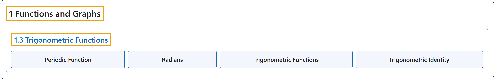

# 1.3 Trigonometric Functions

## Classification

## Glossary

| Term | Definition | 中文翻译 | Source |
|---|---|---|---|
| **1 Functions and Graphs** 函数与图像 | (No definition) | （无定义） | [Strang & Herman, 2016a, chapter 1](https://openstax.org/books/calculus-volume-1/pages/1-introduction) |
| **1.3 Trigonometric Functions** 三角函数 | (No definition) | （无定义） | [Strang & Herman, 2016a, section 1.3](https://openstax.org/books/calculus-volume-1/pages/1-3-trigonometric-functions) |
| **Periodic Function** 周期函数 | "a function is periodic if it has **a repeating pattern** as the values of $x$ move from left to right" | 函数是周期函数，如果当 $x$ 的值从左向右移动时它呈现**重复的模式** | [Strang & Herman, 2016a, chapter 1 Key Terms](https://openstax.org/books/calculus-volume-1/pages/1-key-terms#fs-id1170572481704) |
| **Radians** 弧度 | "for a circular arc of length $s$ on a circle of radius 1, **the radian measure** of the associated angle $\theta$ is $s$" | 对半径为 1 的圆上长为 $s$ 的圆弧，相应角 $\theta$ 的**弧度度量**是 $s$ | [Strang & Herman, 2016a, chapter 1 Key Terms](https://openstax.org/books/calculus-volume-1/pages/1-key-terms#fs-id1170572481719) |
| **Trigonometric Functions** 三角函数 | "functions of an angle defined as **ratios of the lengths of the sides of a right triangle**" | 定义为**直角三角形各边长之比**的角的函数 | [Strang & Herman, 2016a, chapter 1 Key Terms](https://openstax.org/books/calculus-volume-1/pages/1-key-terms#fs-id1170572552272) |
| **Trigonometric Identity** 三角恒等式 | "an equation involving trigonometric functions that is **true for all angles** $\theta$ for which the functions in the equation are defined" | 含三角函数的方程，对使方程中函数有定义的**所有角 $\theta$ 都成立** | [Strang & Herman, 2016a, chapter 1 Key Terms](https://openstax.org/books/calculus-volume-1/pages/1-key-terms#fs-id1170572552282) |

## References

Strang, G., & Herman, E. (2016a). *Calculus volume 1*. OpenStax. Retrieved October 29, 2026, from <https://openstax.org/details/books/calculus-volume-1>
